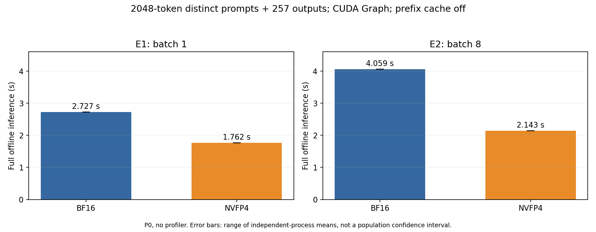
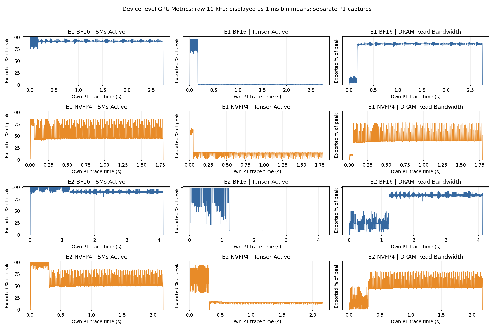
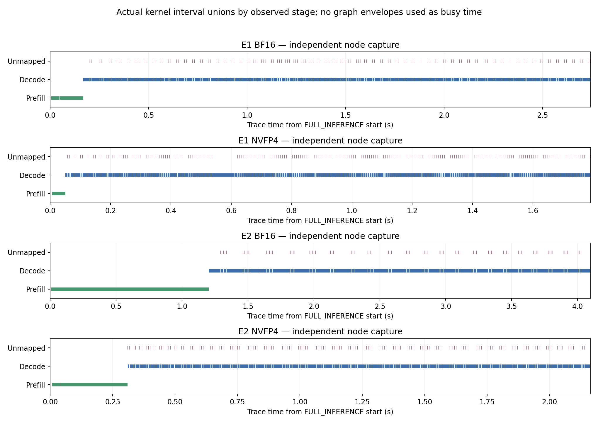
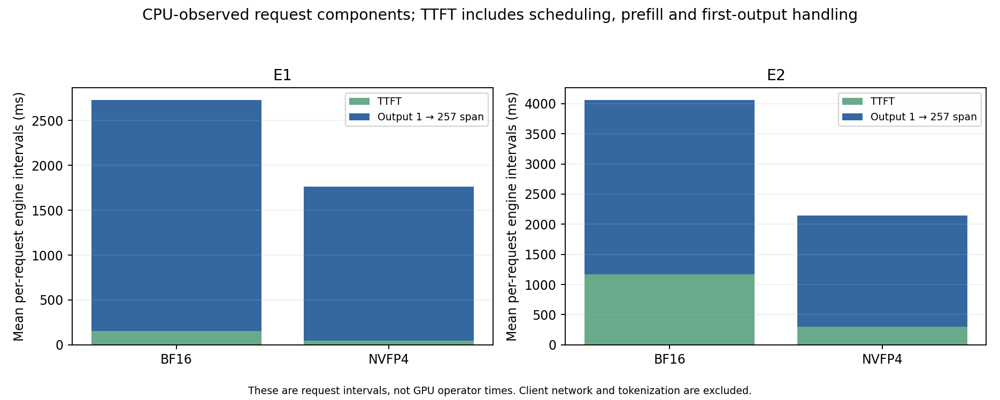

# V4.1 Gate 2：完整推理首轮结果

本报告独立于旧 `nsys_round2`、`resource_overlap_v1` 和 Gate 0/1 CPU准备报告。
它覆盖合法受控 Prompt 的 E1/E2，未进入 Gate 3 或辅助并发 Gate。

## 1. 完成范围与结论边界

- 四组 P0 均已取得有效完整推理，并进行了独立进程复测；详见下表实际数量。
- P1四份设备Metrics、P2四份Node Trace，均独立于正式性能采集。
- 没有NCU注入、没有辅助Kernel并发、没有动态请求或真实文本泛化。
- **RQ1：指定负载下性能与执行族差异有证据；硬件资源差异为单次采样支持。**
- **RQ2/RQ3：UNVERIFIED，未证明可利用资源余量或真实并发优化收益。**

所有执行都有授权窗口、独立空闲检查、外来任务/控制器检查及420秒硬超时。
出现过一次短暂控制器触发，P2首次启动在创建工作负载前被拒绝；后续一次人工
复核确认已消失且GPU空闲，才在原截止时间内恢复，没有延长截止或后台轮询。

## 2. 负载与计时

Qwen3-8B BF16 / NVIDIA NVFP4，SM120，KV统一fp8_e4m3，FLASHINFER Attention，
CUTLASS Linear配置，Graph模式，默认异步调度，Prefix Cache和chunked prefill关闭。
E1 Batch=1，E2 Batch=8；每条输入2048个实际合法Token，两精度ID相同，B8不同Prompt。
输出257个，实际调度核对2048 Prefill Token及256 Decode Token/请求，无抢占。
各次运行观测到256个Replay；随机内部ID与外部ID显式映射。

完整模型时间为预编码 `LLM.generate` 调用窗口，包含请求准备、排队/调度、Prefill、
Decode及输出处理。**不包含本次Tokenization、客户端网络，不能称为在线服务E2E。**
TTFT从逐请求Engine进入到首输出处理，TPOT为首至末输出间隔/256。P95来自逐请求
输出事件，不是整批最慢请求进度。没有在Prefill/Decode交界插入全设备同步。

当前输入仍是明确标记的synthetic_control；真实文本数据虽已准备，E3–E7尚未执行。
完整性能不能与旧Decode-only时间直接混算。

## 3. P0正式性能【VERIFIED，限定本负载和重复范围】

| 组 | 精度 | 独立进程×Run | 完整模型 ms | 进程均值范围 ms | TTFT ms | TPOT ms | 逐请求P95中位数 ms |
| --- | --- | --- | --- | --- | --- | --- | --- |
| E1 | bf16 | 2×5 | 2727.146 | 2726.198–2728.094 | 155.106 | 10.0461 | 10.738 |
| E1 | nvfp4 | 2×5 | 1762.346 | 1761.704–1762.988 | 43.766 | 6.7127 | 7.225 |
| E2 | bf16 | 2×5 | 4059.258 | 4057.422–4061.095 | 1167.927 | 11.2895 | 11.953 |
| E2 | nvfp4 | 2×5 | 2143.128 | 2140.931–2145.326 | 299.865 | 7.1968 | 7.695 |

E1 完整模型加速 **1.547×**，TPOT 加速 **1.497×**。 E2 完整模型加速 **1.894×**，TPOT 加速 **1.569×**。

详细逐请求数据：[e2e_latency.csv](analysis/e2e_latency.csv)；各进程统计与条件内CI：
[gate2_sessions.csv](analysis/gate2_sessions.csv)。每进程5次Run的t区间基于条件独立近似，
不能解释为跨硬件/跨环境的置信区间。独立进程数单列；两个进程仍不足以给出精确
总体CI。没有把256个相邻Decode Step当作独立重复。

TTFT包含调度和首输出处理，其加速不能直接称为纯GPU Prefill加速。输入输出
Hash、实际Batch、调度进度、完整命令、环境和稀疏时钟/功耗记录保留在raw/logs。
BF16与NVFP4输出可以不同，本轮验证的是固定工作量和执行路径，不是模型质量。

## 4. P1/P2扰动【PARTIALLY_SUPPORTED：每条件一次诊断】

| 组 | 精度 | 采集 | 完整窗口变化 % | TTFT变化 % | TPOT变化 % |
| --- | --- | --- | --- | --- | --- |
| E1 | bf16 | P1 | +0.72 | +11.26 | +0.07 |
| E1 | bf16 | P2 | +0.58 | +10.02 | +0.01 |
| E1 | nvfp4 | P1 | +1.59 | +24.42 | +0.99 |
| E1 | nvfp4 | P2 | +1.62 | +20.96 | +1.12 |
| E2 | bf16 | P1 | +1.73 | +5.86 | +0.01 |
| E2 | bf16 | P2 | +0.97 | +3.40 | -0.04 |
| E2 | nvfp4 | P1 | +1.11 | +6.40 | +0.14 |
| E2 | nvfp4 | P2 | +0.98 | +4.93 | +0.23 |

比较均使用相同配置文件、Prompt Manifest和worker源码Hash。表中是观测差额，
混合了采集影响与进程/频率波动，不宣称是Profiler开销的精确因果估计。
尤其TTFT较短时相对扰动可大于完整窗口；阶段资源结论保留这一限制。

## 5. 设备级资源【PARTIALLY_SUPPORTED，单份P1采样/条件】

完整CPU请求窗口的时间加权均值，单位均沿用NSYS导出的% of peak：

| 组 | 精度 | SMs Active % | SM Issue % | Tensor Active % | DRAM Read % |
| --- | --- | --- | --- | --- | --- |
| E1 | bf16 | 91.34 | 10.58 | 5.40 | 81.32 |
| E1 | nvfp4 | 51.40 | 5.66 | 14.58 | 43.44 |
| E2 | bf16 | 92.35 | 6.67 | 34.25 | 64.16 |
| E2 | nvfp4 | 61.02 | 8.11 | 23.21 | 45.54 |

映射到DECODE模型活动包络内的设备级条件均值：

| 组 | 精度 | SMs Active % | SM Issue % | Tensor Active % | DRAM Read % |
| --- | --- | --- | --- | --- | --- |
| E1 | bf16 | 91.24 | 10.68 | 0.41 | 86.05 |
| E1 | nvfp4 | 45.11 | 4.79 | 15.29 | 38.79 |
| E2 | bf16 | 89.85 | 5.40 | 10.24 | 81.78 |
| E2 | nvfp4 | 51.04 | 6.59 | 16.65 | 45.88 |

**第二张表不是完整Decode阶段的无条件平均，更不是单Kernel专属利用率。** 它按
已关联的模型活动包络筛选样本，排除了尚未关联的活动与部分间隔。不能直接拿它
与旧报告“整个Decode窗口”均值比较。全窗口与阶段条件视图分别保留。

现象包括DRAM/SM活动降低、部分配置Tensor活动升高、SM Issue并非统一降低；这些
支持资源使用结构改变，不能换算成“剩余多少CUDA Core/Tensor FLOPs”。Prefill与
Decode的权重不同也会改变完整窗口均值，不能只比较全窗口就归因到具体算子。

例如E2的完整窗口Tensor Active从34.25%降到23.21%，而已关联Decode包络内的条件均值
从10.24%升到16.65%。二者统计范围不同；不能笼统宣称FP4使Tensor管线活动整体升高或降低。

每份P1均重新检查SessionNs、PCI/UUID、Context、样本范围、约100μs间隔与缺口。
原始采样及指标定义以gzip无损保留；负/异常频率字段未修复，未验证的频率不参与
分析。时钟、功耗、温度另见两秒周期监督原文，不能据其做高分辨率能耗积分。

## 6. P2实际Kernel路径与时间轴【VERIFIED，限定这些Trace】

| 组 | 精度 | Kernel数 | Node采集Coverage % | 未归属Kernel数 | 未归属活跃时间比 % |
| --- | --- | --- | --- | --- | --- |
| E1 | bf16 | 106420 | 98.89 | 2570 | 7.55 |
| E1 | nvfp4 | 134176 | 98.03 | 2570 | 11.66 |
| E2 | bf16 | 106420 | 99.15 | 2570 | 4.85 |
| E2 | nvfp4 | 134176 | 98.12 | 2570 | 9.32 |

Coverage使用实际Kernel区间并集；不是SM利用率。P1的256个Graph外包络从未被
用作Kernel Coverage。P2与P1是独立执行，不把两者拼成同次事件或利用率。

实际名称族确认：BF16 B1的Decode主要为cuBLAS GEMV族，B8主要为WMMA族；NVFP4
两种Batch均观测到37008个带SM120/E2M1类型的实际Kernel执行记录。该计数是Kernel
调用数，不是动态MMA指令数。检查使用真实执行记录，未以二进制“包含符号”代替。

NVFP4还保留每Token一次的BF16 GEMV/WMMA类执行。其精确逻辑归属仍需调用/Graph
构建映射；不能单靠名称强行分配Layer或宣布就是某个算子。FP4总Kernel数比BF16
多27756，额外成本的完整拆分留给Gate 3，不能把计数差直接都归为量化。

每份Trace有2570个Kernel未归属到当前execute_model标记。未归属部分占活跃时间的
比例见表，对FP4并不小，**不能删掉后称为完整阶段画像**。后续应补采样/输出路径
等实际调用关联；目前保留UNKNOWN。每个名称族的时间、Registers、Shared Memory、
Block等可获取数据见 [kernel_catalog.csv](analysis/kernel_catalog.csv)。逻辑Layer、算子、
padded M未验证的部分明确缺失。没有取得动态Warp Stall、实际Occupancy或L2命中率。

## 7. Amdahl与下一步的具体边界

名称能明确识别的FP4量化Kernel只是量化/布局工作的子集，融合部分不能单独拆出。
这个子集在P2中的活跃时间约为B1 25.1ms、B8 50.1ms；分母必须使用各自P2窗口，
不能与P0混算。这提示不能只因“FP4存在量化步骤”就将其选为端到端主优化项；
全部量化及上下游链成本仍需可靠算子映射。

图中的请求分解是CPU观察的TTFT/输出跨度，不是GPU算子净时间。当前观察到较低
设备活动与约98%–99%的Kernel时间覆盖共存，支持区分时间空隙和资源结构；两组
数字来自不同采集，不能乘算“可用SM百分比”。额外CTA能否进入还取决于寄存器、
共享内存、Warp与调度。一个主CTA占用较多SMEM不自动排除更小辅助CTA，也不证明
它能无干扰运行，必须通过后续受控共存试验判断。

## 8. 失败、限制与下一Gate

早期14:14试跑因内部/外部请求ID映射错误退出；已修复并通过CPU回归。14:22重跑
被其他用户计算阻止。17:44后取得本报告有效数据，失败和被拒绝的记录未计入基线。
一次CPU资源汇总超时只影响后处理；已终止确认属于本项目SQLite的CPU进程，未
重跑或改写原Trace。线性汇总与旧实现100个随机差分案例完全一致，worker代码
保持冻结。详见 [gate2_failures.md](analysis/gate2_failures.md) 及对应监督日志。

仍未完成：真实文本泛化、自然EOS、Teacher Forcing、Prefix Cache专项、Mixed请求、
重点逻辑算子完整映射、P1独立重复、NCU可用性与真实并发。**Gate 2的基础采集
已取得，阶段/算子归因保留缺口，不自动进入Gate 3或Gate 6。**

全部大型.nsys-rep/SQLite留在服务器，位置与SHA256见
[gate2_raw_trace_manifest.json](analysis/gate2_raw_trace_manifest.json)。压缩后的原始指标、
Kernel区间与元数据可用于复核。历史数据没有覆盖；CPU准备快照见原提交979d88d。
当前没有证据宣布NVFP4资源余量可利用，更没有真实辅助工作带来的LLM加速结论。

本轮GPU工作在2026-11-17 18:37:42 CST已结束，授权窗口主动关闭，未留下实验进程或permit。
状态快照见[gate2_completion_state.json](analysis/gate2_completion_state.json)。这是完成时状态，
不是对后来GPU可用性的承诺。代码/数据复核见[gate2_quality_validation.json](analysis/gate2_quality_validation.json)。
原CPU准备产物清单属于979d88d快照；本轮另建Gate 2清单，不覆盖旧快照。
