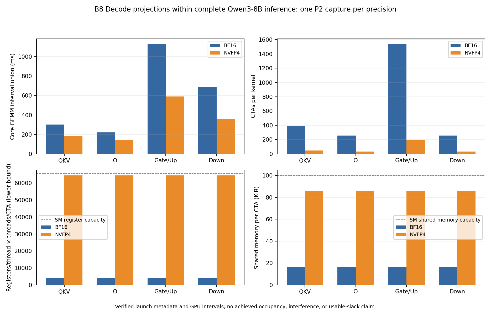

# Gate 3：E2 Decode 的逐层投影与静态资源对照

## 本轮范围与状态

基于此前Gate 2完整推理与Gate 3的LM Head归因，增加一份NVFP4及一份BF16的完整推理P2补采。
同为Batch=8、不同合法Prompt各2048 Token、输出257 Token、256次真实Decode，KV为fp8_e4m3，
关闭Prefix Cache与Chunked Prefill，保持Graph路径和既有配置。没有重跑P0，没有NCU或辅助并发。
输入沿用Gate 2的`synthetic_control`硬件控制组，不是自然语言应用泛化；E3—E7尚未在本轮执行。

已核验两种精度各**36层×4类投影=144个模块**，各映射**36864次Decode主GEMM**；
每个模块均有256条实际执行记录。单次采样的测量边界与统计限制保留，不把Kernel次数当独立实验重复。

**这是E2 Decode主投影GEMM归因的阶段结果，不是整个Gate 3已经完成。** Prefill逐算子、Attention、
量化/布局/激活融合链、E1的相应验证，以及动态缓存和调度计数仍有缺口。RQ2/RQ3未开展。

## 如何确认节点身份

在PyTorch的Graph post-instantiate hook中读取仍存活的Graph；由Driver API取得Kernel参数大小，
只复制该大小的CPU参数值，不读取GPU权重内容。再将其中精确引用的设备地址与真实模块的
weight、weight_scale、alpha等张量地址匹配，要求唯一模块，并在本次144个节点中核实实际weight引用。
最终用CUDA tools ID与NSYS的实际Graph Node ID精确连接，同时核对Graph ID、Grid和Block。

没有按调用顺序、耗时、Kernel名字或CPU/GPU时间重叠来分配Layer。捕获的Graph对象身份也与每次
Replay显式关联；未修改Graph节点、未开启debug保留、未改变实例化策略，未插入逐层forward hook。

本轮实际使用Graph的144个主GEMM节点均唯一关联模块；包含权重、scale、alpha的精确引用证据保留在
[NVFP4映射表](analysis/graph_operator_mapping.csv)及
[BF16映射表](../gate3_backbone_bf16/analysis/graph_operator_mapping.csv)。
每个参数只在Driver报告的大小内读取；存在歧义或无引用时不允许按顺序补标签。

API依据：[PyTorch CUDAGraph](https://docs.pytorch.org/docs/stable/generated/torch.cuda.graphs.CUDAGraph.html)、
[CUDA Graph API](https://docs.nvidia.com/cuda/cuda-driver-api/cuda_driver_api/group__CUDA__GRAPH.html)、
[Kernel参数布局API](https://docs.nvidia.com/cuda/cuda-driver-api/cuda_driver_api/group__CUDA__EXEC.html)。
本机CPU API检查记录包括Torch2.14.0+cu132、cuda-bindings13.5.0，检查时CUDA未初始化。

## 路径完整性和标记扰动

| 项目 | BF16 | NVFP4 |
| --- | --- | --- |
| 实际Kernel总数 | 106420 | 134176 |
| 直接匹配Decode投影执行 | 36864 | 36864 |
| 相对各自Gate 2 Kernel名称多重集合 | 完全一致 | 完全一致 |
| 本次完整模型P2墙钟 ms | 4106.821 | 2160.561 |

Kernel构成一致支持没有明显改变计算路径，但一次P2对照不能给出严格的扰动置信区间，
也不是新的正式性能基线。P0正式性能仍以原Gate 2结果为准。

## 同一逻辑投影的主GEMM对照

下表只统计256次Decode中实际投影Kernel区间并集。它**不包含该逻辑算子的全部量化、激活和布局成本**，
不能当作完整FFN Block或Attention Block的净时间，也不是P0性能加速声明。

| 逻辑投影 | BF16 Kernel并集 ms | NVFP4 Kernel并集 ms | BF16 CTA/Kernel | NVFP4 CTA/Kernel |
| --- | --- | --- | --- | --- |
| qkv_proj | 300.165 | 180.144 | 384 | 48 |
| o_proj | 220.497 | 139.308 | 256 | 32 |
| gate_up_proj | 1128.324 | 590.864 | 1536 | 192 |
| down_proj | 691.682 | 358.367 | 256 | 32 |

NVFP4四类主GEMM并集约1268.682ms，占同次完整P2窗口约
58.72%。其中Gate/Up与Down两类主GEMM
合计约949.230ms，占完整P2窗口约43.93%；这给后续研究提供了可观测的大项，仍不能忽略其上下游链。
不能把该比例与P0时间混算Amdahl上界。

逐层结果：[NVFP4](analysis/layer_operator_timing.csv)、
[BF16](../gate3_backbone_bf16/analysis/layer_operator_timing.csv)。

## 真正值得注意的资源变化

| Launch静态属性 | BF16 | 原生NVFP4 |
| --- | --- | --- |
| 线程/CTA | 32 | 384 |
| Registers/thread | 124 | 168 |
| Registers×threads/CTA，下界 | 3968 | 64512 |
| Dynamic Shared Memory/CTA | 16896 B，16.5 KiB | 88064 B，86 KiB |
| Static Shared Memory/CTA | 0 | 0 |
| 四类投影的CTA总数 | 384/256/1536/256 | 48/32/192/32 |

这四类Kernel中，NVFP4的CTA数量为BF16的八分之一，而每CTA的线程数为12倍。
因此“任务整体更快”不能推出“每个活跃SM的可分配资源更多”。变化是Grid变窄、CTA变重，
不同投影的Grid规模又不同，需要区分同SM共驻与其他SM执行。

NSYS设备元数据报告每SM有65536个32-bit寄存器和102400B Shared Memory。以报告的每线程寄存器
乘线程数计算，单个FP4主CTA至少需64512个寄存器，剩余寄存器上界仅1024；分配粒度可能进一步收紧。
因此，一个至少64线程、每线程至少32寄存器的辅助CTA，仅按这一上界就不能与该主CTA同SM驻留。
这不排除更小探针，也不排除辅助CTA在其他SM上执行。

只按Shared Memory容量计算，FP4同类主CTA驻留上界为1，BF16为6；这只是其中一个资源约束，
**不是Achieved Occupancy，也不证明实际同时驻留了6个BF16 CTA**。

另一方面，QKV、O、Down的FP4 Grid总共仅48、32、32个CTA。单个此类Kernel自身的并行SM数受Grid
上界限制，但完整推理同刻可能还有其他Kernel，不能直接把170减Grid值称为“空闲SM”。
这提示下一阶段应分别验证空间调度与同SM共驻，而不能仅看Tensor Active低就注入任意辅助工作。

## 证据等级与未取得的指标

- **VERIFIED（限定E2 Decode两份新Trace）**：模块权重引用、Graph/Node连接、四类主GEMM的Launch元数据和GPU区间。
- **已验证输入数据上的理论推导**：寄存器最小需求、SMEM单资源驻留上界、单Kernel Grid并行上界。
- **PARTIALLY_SUPPORTED**：标记未明显改变执行路径；缺少同一新标记条件下的独立性能重复。
- **UNVERIFIED/UNAVAILABLE**：实际Occupancy、Eligible Warps、Warp Stall、FP32/INT Pipe、L2/L1硬件计数和瓶颈因果归因。
- **UNVERIFIED**：额外任务能否进入、实际重叠/干扰、同SM共驻、真实有用计算及推理收益。

每个精度只有一个有效P2补采。不同精度输出Token序列可不同；固定了输入和工作负载形状，未做Teacher Forcing。
没有把设备级GPU Metrics分配到短Kernel，也没有用静态元数据冒充动态计数器。

## 失败、网络事件与GPU释放

BF16首次采集器在`matrix_kernels`字段上不一致，发生于正式捕获前，由监督器于22:17:45停止，
没有有效Trace或性能样本。失败源码与日志保留。修复后新增CPU模拟Graph的capture/bind/replay契约测试，
再在原22:31:52截止前以r02重试，没有延长窗口。中途SSH曾重置/超时；恢复后先检查监督器、进程、permit
和文件，未因断连盲目重跑。r02完整完成，SQLite quick_check为ok。

NVFP4窗口22:08:56关闭；BF16窗口22:27:28关闭。两次完成状态均记录无计算任务、无permit；
BF16最终记录还核实无实验进程。此后仅CPU分析，无自动下一Gate。
见[前者](analysis/completion_state.json)和
[后者](../gate3_backbone_bf16/analysis/completion_r02.json)。

大型原始JSON、SQLite和.nsys-rep留在服务器，路径及SHA见两侧的`analysis/raw_trace_manifest.json`。
原始JSON另以无损gzip入库，Kernel区间、逐层映射、原始日志及失败档案均可复核。

## 接下来的范围

本轮解决了E2 Decode四类核心投影的身份和静态Launch资源对照。后续需要补齐Prefill、Attention及融合链
的必要归因，并以经过正确性验收的探针验证资源竞争。当前证据足以提出具体竞争假设，
仍不足以宣布“FP4已经释放了可利用算力”。不自动跳到并发Gate。
