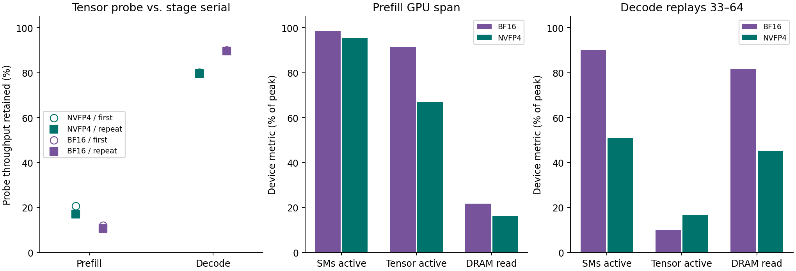

# RTX 5090 完整 E2 资源竞争复验

2026-11-19，北京交通大学 RTX 5090。沿用 Gate 4.4 两种精度的 Qwen3-8B、CUDA Graph、FP8 E4M3 KV。每次执行 8 条不同的受控输入，各 2048 个输入和 257 个输出 token。首个输出后实际执行 256 次 Decode。测量范围为本机预编码输入进入 vLLM 后的完整推理。

## 同一探针的阶段排序

保持辅助工作量、提交位置和串行对照一致。在 Prefill 排入主工作后注入一次，在 Decode 的第 33 至 64 次调度各注入一次。每次均执行 64 CTA、256 个输出 tile 的 BF16 Tensor MMA。每种精度的并发与串行分别新开进程。下表为每阶段「串行辅助 Kernel 累计时长 / 并发辅助 Kernel 累计时长」。串行参照条件是在相同推理阶段让 B 执行完再执行目标主任务。每个并发探针均已逐值核验输出。

| 阶段 | NVFP4 上轮 | NVFP4 本轮 | BF16 上轮 | BF16 本轮 |
|---|---:|---:|---:|---:|
| Prefill | 20.7% | 17.0% | 12.0% | 10.7% |
| Decode | 80.1% | 79.6% | 89.9% | 89.6% |

两份独立生命周期采集中，精度排序均随阶段反转。本轮两种精度各 33/33 个并发探针与目标执行相交，串行均为 0/33。Prefill 每份轨迹只有一次注入，能复现排序的方向，具体百分比随注入落点变化。32 个 Decode 步属于一次进程内观测。[逐进程 P2 对照](analysis/phase_recheck_20261119/phase_comparison.csv)

## 探针在 Decode 实际遇到了什么

按设备、Context、Stream、Graph、CUDA API correlation 和真实 GPU 起止时间筛选主活动。逐次重建的邻近 Kernel 时间并集与独立验证的主任务交集完全一致。以下百分比的分母为 B 与主任务已验证的 GPU 重叠时间。Kernel 家族和启动形状取自本次轨迹，跨进程模块实例身份没有重新验证。[逐次原始交集和完整符号](analysis/phase_recheck_20261119/neighbors/)

- NVFP4 下，72.9% 与一个 48 CTA 的原生块缩放 CUTLASS GEMM 相交，21.3% 与融合 embedding、RMSNorm、FP4 量化的 Kernel 相交，5.8% 与独立 FP4 转换相交。
- BF16 下，75.0% 与一个 384 CTA 的 CUTLASS BF16 GEMM 相交，25.0% 与融合 embedding、RMSNorm 的 Kernel 相交。两种精度的 GEMM 形状均与此前 Gate 3 的 QKV 主投影对应。这个探针覆盖的是 Graph 入口附近，已知 32 CTA 的 NVFP4 FFN Down 没有出现在这些交集中。
- NVFP4 和 BF16 的探针 GPU 起点中位数分别比目标 Graph 第一个主 Kernel **早 0.54 和 1.22 µs**。从 B 自己的 GPU 起点到终点，中位时长分别为 **20.34 和 17.62 µs**，等工作量阶段串行约为 **16.11 和 15.78 µs**。因此 NVFP4 在这个 Decode 位置的相对减速发生在探针执行区间内；B 在主 Graph 开头迟迟没有启动的解释与这些时间戳不符。Kernel 区间仍包含设备内部停顿。主机提交至设备开始的较长间隔还包含排队和前置依赖，无法据此计算 CTA 入驻延迟。
- Prefill 的落点更不稳定。上轮 NVFP4 探针主要覆盖融合变换及 KV 写入，这一轮主要覆盖 SiLU/FP4 转换和 GEMM。Prefill 探针获得的时间属于显式提交位置附近，不能代表整段 Prefill 的所有位置。[各 Kernel 家族相交比例](analysis/phase_recheck_20261119/overlapping_families.csv)

## 设备资源

独立做四次 10 kHz、GB20x 的 P1 采集，分别为 BF16/NVFP4、主任务单独/加入短探针。核验物理 UUID、单设备、子进程、采样时间源、NVTX 到真实 CUDA 启动的关联以及 256 次 Decode replay。Prefill 取其主活动首次开始到末次结束的跨度，Decode 取选定 32 个 Graph 的 GPU 包络，移除 replay 之间的间隙。两者均是阶段内设备均值。下表为主任务单独执行时 NSYS 导出的百分比。

| 本轮主任务 | SMs Active | SM Issue | Tensor Active | Compute Warps in Flight | DRAM Read | DRAM Write |
|---|---:|---:|---:|---:|---:|---:|
| NVFP4 Prefill | 95.3 | 18.6 | 67.0 | 29.6 | 16.4 | 14.9 |
| BF16 Prefill | 98.4 | 9.8 | 91.5 | 11.6 | 21.7 | 4.1 |
| NVFP4 Decode 33–64 | 50.7 | 6.5 | 16.8 | 10.9 | 45.3 | 1.0 |
| BF16 Decode 33–64 | 90.0 | 5.3 | 10.2 | 6.3 | 81.6 | 1.0 |

NVFP4 在这段 Decode 的阶段平均 DRAM Read 较低，探针相对串行的吞吐却更低。单一带宽或 SM 活动均值无法预测这个短 Tensor 探针的表现。Tensor Active 的跨精度排序与本次探针竞争方向相符，但 P1 的约 100 µs 采样周期大于 Decode 探针时长，无法将单探针减速直接归因于 Tensor 发射、显存、Cache 或 Warp Stall。P1 和 P2 来自不同进程，使用相同输入与配置，未跨进程对齐绝对时间。[设备指标与采样覆盖](analysis/phase_recheck_20261119/device_metrics.csv)

## 复核入口

本轮 10 个独立进程完成 4 份 P2、4 份 P1，以及 2 个无 Profiling 的配对实验。P0 每种精度各五个四条件配对块，共 40 次完整 E2 推理。相同精度下，所有采集的输入和输出 token 哈希相同。P1 相对同轮、同精度、同条件 P0 均值的完整推理时长高 0.75%–1.58%。这些差额包含独立运行的波动。[P1 扰动](analysis/phase_recheck_20261119/p1_overhead.csv)

| P0 完整请求 | 主任务单独 | 加入探针 | 配对主任务延迟变化，95% 描述性区间 | 实测串行 / 并发联合完成时间 |
|---|---:|---:|---:|---:|
| NVFP4 | 2166.347 ms | 2169.422 ms | +0.15%（−0.90% 至 +1.19%） | 0.9994×（0.9941–1.0046×） |
| BF16 | 4086.750 ms | 4089.711 ms | +0.07%（−0.23% 至 +0.38%） | 0.9995×（0.9981–1.0010×） |

两种精度的联合收益区间都跨 1。探针的工作量足以观察竞争方向，尚未产生可重复的请求级速度提升。这里的区间来自同一已加载引擎内的五个配对块，独立进程复验单独保留。[无 Profiling 配对统计](analysis/phase_recheck_20261119/lifecycle/statistics.csv) 北京时间 14:18:07 完成释放检查，无计算进程、残留许可或已知控制器。[释放记录](analysis/phase_recheck_20261119/release_status.json)

GPU 采集经原 E2 supervisor 的单次授权、计算进程、控制器和硬超时检查。每一条件单独开进程。P2 入口为 `run_gate44.py --phase lifecycle --condition parallel|serial --profile P2`，P1 为 `--condition parallel|a_alone --profile P1`，无 Profiling 的 P0 为 `--condition paired --profile P0`。其余配置与监督参数见各次监督日志。服务器保留原始轨迹，本地归档含压缩请求结果、日志、SQLite/Trace 哈希和逐次交集。[本轮运行档案](raw/phase_recheck_20261119/) · [输入输出和工作量核验](analysis/phase_recheck_20261119/run_inventory.csv)

在有原始 SQLite 的主机，用 `analyze_gate44_neighbors.py <V4目录> <P2运行ID>` 或 `analyze_gate44_stage_metrics.py <V4目录> <P1运行ID>` 分别取得逐次交集和设备指标 JSON。汇总入口为 `summarize_phase_recheck.py`、`analyze_gate44_p0.py`、`audit_phase_recheck.py`。本轮没有直接的 CTA 级 SM 位置或 Kernel 专用 FP32、L2、Warp Stall 计数。DRAM 探针验收和有真实下游消费者的加速实验另行评估。
