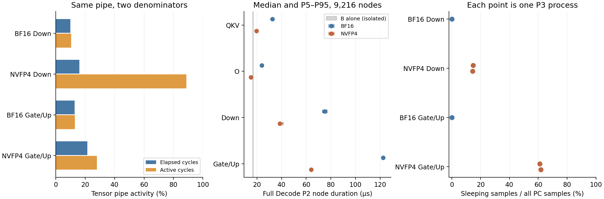
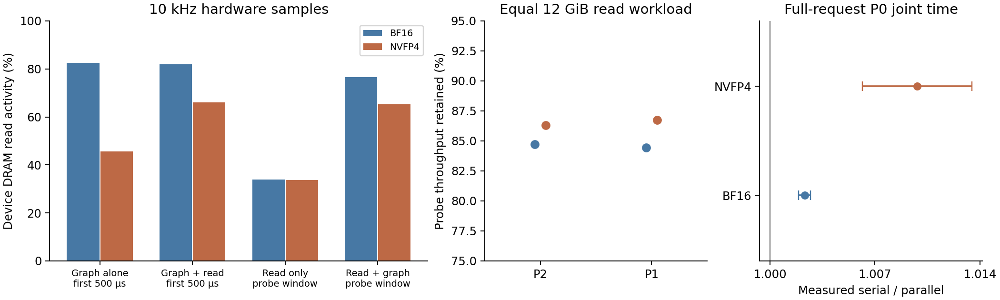

# RTX 5090 上八个 Decode 核心投影的微架构实测

以 `db46e14` 为历史对照。本轮最明确的发现出现在 NVFP4 FFN Down 上。用整个 Kernel 的经过周期作分母，Tensor 管线活动约为 **16%**。改用活跃周期作分母，得到 **88.7%**。同一算子的 32 个高资源 CTA 覆盖范围有限，同时工作中的 SM 有很密集的 Tensor 指令。这解释了为什么一个额外 Tensor 任务有机会在 GPU 上完成，也给“空出的 Tensor 算力”这个说法加上了具体的空间和时间条件。[八个投影的完整对照](analysis/projection_comparison.csv)

## 设备、输入与计时

43 个独立的 Nsight Compute 2026.2.1 进程在同一张 RTX 5090 上完成。每次采集第 18 层一个真实投影的单节点诊断 Graph，M=8，使用 checkpoint 权重和确定性 BF16 激活。NVFP4 激活在测量前量化。核验了权重与 scale 地址绑定、完整 mangled symbol、Grid/Block、寄存器、共享内存及三次逐位一致的输出。NCU 报告中的唯一 action 与现场 CUDA 函数符号完全匹配。直接从报告导出的 SASS 包括 BF16 的 `HMMA.16816.F32.BF16` 和 NVFP4 的 `OMMA.SF.16864.F32.E2M1.E2M1.UE4M3.4X`。[指令记录](analysis/sass_opcode_counts.csv) · [逐进程原始数据](raw/)

每个精度、每个投影有两份默认缓存策略的 31 指标画像。另有四份清缓存对照、八份调度与 stall 专项、八份 L2 读取对照、六份指令地址采样和一份采集链路验证。正式的无 Profiling 干扰数据沿用历史六个配对块。完整 Decode 的算子时间取自 Gate 3 的另一次真实模型 P2。P0、P2、P3 保留各自的计时边界；报告中没有跨进程拼接时间戳。[计数器与单位](analysis/measurements.csv) · [重复范围](analysis/summary.csv) · [历史 P0/P2](../gate4_spatial/qkv_replay_validation/tensor_projection_extension_20261119.md)

## 一、不同投影在哪里消耗资源

以下为单独运行的核心 GEMM。Tensor 两列的分母依次为 elapsed cycles 和 active cycles。可发射 warp 取每个活跃 SM 子分区每周期的平均数。逻辑 TFLOP/s 按 `2MNK` 除以历史 P0 六块中主任务单独执行的 CUDA Event 时长中位数计算，只计模型请求的有效乘加。

| 精度 | 投影 | CTA 数 | 逻辑 TFLOP/s | Tensor 活动，elapsed / active | FMA 管线，elapsed | 可发射 warp | Long scoreboard |
|---|---|---:|---:|---:|---:|---:|---:|
| BF16 | QKV | 384 | 17.9 | 14.5% / 16.3% | 0.03% | 0.17 | 32.9% |
| NVFP4 | QKV | 48 | 19.7 | 17.3% / 76.4% | 0.25% | 0.28 | 4.8% |
| BF16 | O | 256 | 13.1 | 12.5% / 15.1% | 0.03% | 0.18 | 31.7% |
| NVFP4 | O | 32 | 14.6 | 13.6% / 78.9% | 0.19% | 0.29 | 4.0% |
| BF16 | Down | 256 | 11.2 | 9.8% / 10.4% | 0.01% | 0.13 | 52.0% |
| NVFP4 | Down | 32 | 17.9 | 16.0% / 88.7% | 0.12% | 0.29 | 2.8% |
| BF16 | Gate/Up | 1536 | 12.9 | 12.8% / 12.9% | 0.03% | 0.06 | 80.2% |
| NVFP4 | Gate/Up | 192 | 23.8 | 21.5% / 28.0% | 0.34% | 0.11 | 3.6% |

**FP32。** 四组中 NVFP4 的 FMA 管线活动都略高。以 Gate/Up 为例，NVFP4 核心投影实际执行 3,145,728 条按线程计的 predicated-on FFMA，BF16 核心投影为 0；后者仍有 FMUL，两者的矩阵乘加均走 Tensor 路径。由此无法支持“四种投影换成 FP4 后会少用 FP32 管线”的假设。两边整体 FMA 活动都很低，FFMA 计数也只覆盖一种指令。额外 FP32 任务的可用吞吐仍须看同工作量竞争实验。[分项动态指令与管线计数](analysis/summary.csv)

**驻留。** NVFP4 实测 384 threads/CTA、168 registers/thread、88,064 B 动态共享内存；BF16 为 32、124、16,896 B。对现场函数调用 CUDA Occupancy API，分别允许每 SM **1 和 5 个同类 CTA**。NVFP4 每 CTA 的寄存器数按线程乘得 64,512 个，距 65,536 个物理上限仅余 1,024 个，尚未计入异类 CTA 的分配粒度。实测 `sm__ctas_active.avg.per_cycle_active`，NVFP4 四个投影约 1，BF16 Down 约 1.43、Gate/Up 约 4.61。混合 CTA 仍无同 SM 位置观测。[现场函数属性和硬件计数](analysis/measurements.csv)

## 二、为什么 Down 和 Gate/Up 会有不同的并发表现

NVFP4 Down 的 SM 活跃周期占经过周期约 **18.2%**，与 32 CTA 在 170 SM 上可同时覆盖至多 18.8% 的上限接近。NVFP4 Gate/Up 的 Grid 扩大至 192 CTA，SM 活跃周期约 **76.6%**，Tensor 在活跃周期内的活动反而降至 **28.0%**。Down 的潜在机会集中在主投影未覆盖的 SM；Gate/Up 会有更多 SM 带着一个高资源 CTA 等待。以上是资源和时间线的联合解释，没有逐 CTA 实际 SM 编号。

针对等待原因另做了 PC 采样。NVFP4 Gate/Up 两个独立进程的 sleeping 样本分别为 **3,302 / 5,412** 和 **3,349 / 5,417**。其中 **98.0% 和 97.9%** 落在静态前序指令为 `NANOSLEEP.SYNCS` 的 `SYNCS.PHASECHK` 地址。NVFP4 Down 对应的 sleeping 比例为 **14.9% 和 14.5%**。两个 BF16 对照分别采到 12,413 和 7,591 个 PC 样本，sleeping 类均为零。这里的分母是被采样的 warp 状态。静态相邻指令不证明每次动态执行的分支路径。[逐次 PC 汇总](analysis/pc_waits.csv) · [采样地址与前序指令](raw/)

与历史并发测量联读，NVFP4 Down 的固定 Tensor 探针保留 **92.2%–93.1%** 吞吐，探针结束距主投影结束约 26 µs；Gate/Up 只保留 **14.4%–14.5%**，探针约晚于主投影开始 46.6 µs 才在 GPU 上进入。BF16 Gate/Up 同样压低探针吞吐（约 16.4%），其主核的 long scoreboard 却占约 80%，读 DRAM 压力也高。**相近的辅助任务减速可伴随不同的主核等待状态。** NVFP4 的等待地址已经定位；把全部探针减速归给某条同步指令、某个 TMA 生产者或片上某一资源，仍缺少改变该因素的等工作量对照。[原有 P2 重叠与 P0 配对](../gate4_spatial/qkv_replay_validation/analysis/tensor64_projection_comparison_20261119.csv)

## 三、缓存如何改变读显存的结论

保留预热后的缓存与 NCU 在回放前清缓存，得到了不同的物理读流量。下表以十进制 MB 计，默认列为两个进程的中位数，清缓存列每项一次。

| 投影 | BF16 默认 / 清缓存 | NVFP4 默认 / 清缓存 |
|---|---:|---:|
| Down | 73.24 / 100.88 MB | 1.11 / 28.50 MB |
| Gate/Up | 197.83 / 201.45 MB | 14.52 / 56.71 MB |

BF16 Gate/Up 的原始权重约 192 MiB，超过实测 96 MiB L2 容量。NVFP4 Gate/Up 的打包权重加每 16 值一个 1 B scale 约 54 MiB，Down 约 27 MiB。在单层重复访问下，NVFP4 的读量对预热敏感。完整推理还要访问其他层、KV 和中间张量，无法直接套用这些绝对值。BF16 Gate/Up 高 long-scoreboard 与高 DRAM 吞吐共同支持该孤立形状存在显著访存压力；仅靠 long-scoreboard 不能区分 L1、L2、DRAM 或独立的访存并行度限制。

有六个多 pass 的全操作 L2 命中率读数超过 100%。原始值保留并标记无效，汇总排除它们。另以专用读取 hit/miss sector 的窄指标集复核，NCU 仍使用三次 replay。单层 NVFP4 各投影预热后读取大多命中，BF16 Gate/Up 约 19.7%。这组数只描述读 lookup，且跨 pass 的缓存状态可能变化。L1 活动与 hit rate、L2 sector 数与吞吐、DRAM 读写字节均已保留。当前没有证据宣布 L2 成为完整模型的新瓶颈。[读取计数](analysis/l2_read_lookups.csv) · [原始异常标记](analysis/measurements.csv) · [NCU 的测量与缓存控制定义](https://docs.nvidia.com/nsight-compute/ProfilingGuide/index.html)

## 四、回到真实完整推理

对 Gate 3 两份真实 E2 Node Trace 重新统计，BF16 和 NVFP4 各有 **36 层 × 4 投影 × 256 步** 的绑定记录。NVFP4 O 与 Down 都是 32 CTA，实际 Decode 节点的中位数却是 **14.976 µs 和 38.625 µs**。对照约 16.7 µs 的既有 Tensor 探针独立时长，O 的 9,216 次中仅 1 次达到参照，Down 为 9,216 次全部达到。Gate/Up 也全部达到，历史并发观测仍显示严重干扰。节点总时长描述容纳工作的时间尺度，能否兑现还取决于辅助任务的 GPU 起点和在竞争中的执行速度。

NVFP4 Down 的核心 GEMM 占其整次 P2 模型窗口的 **16.6%**。历史完整 E2 Tensor 探针在 Decode Graph 入口注入，实际交集包含 48 CTA 投影和量化等入口 Kernel，没有命中 Down。该入口的排序无法直接推翻或复现 Down 的孤立结果。原有六块 P0 支持 Down 的局部联合收益，当前尚无真实下游工作在完整请求中利用该窗口并提高服务吞吐的证据。[分层时长与分布](analysis/full_decode_duration_bounds.csv) · [入口邻近算子对照](../gate4_inference/phase_recheck_20261119.md)

## 五、完整 Decode 中显存探针的竞争

针对 `db46e14` 留下的带宽问题，补采四份 10 kHz NSYS P1 和两个无 Profiling P0 进程。仍使用 E2、8 条不同输入、每条 2,048 输入和 257 输出、FP8 KV、关闭前缀缓存。Decode replay 33–64 每次读取独立的 384 MiB 工作集，累计 12 GiB 逻辑读取，输出逐项校验。两种精度均有独立的串行及并发轨迹。P1 的内点采样使用同一 Trace 中的 GPU 起止时间。此前 P2 已确认该条件的 32/32 次实际 Kernel 重叠和串行的 0/32 次重叠。

| 指标 | BF16 | NVFP4 |
|---|---:|---:|
| Graph 首 500 µs 设备读活动，B 已经串行完成 | 82.6% | 45.5% |
| Graph 首 500 µs 设备读活动，B 并发 | 81.8% | 66.1% |
| B 独自执行窗口的设备读活动 | 33.9%（156 样本） | 33.7%（158 样本） |
| B 与 Graph 相交窗口的设备读活动 | 76.6%（196 样本） | 65.3%（191 样本） |
| P1 辅助吞吐保持率，按 B GPU 时长计算 | 84.4% | 86.7% |
| P0 主请求增加的模型窗口时间 | +0.37% | +0.44% |
| P0 注入 32 步的逐请求输出间隔均值变化 | +3.00% | +2.39% |
| P0 实测等工作量串行 / 并发联合时间 | 1.0023× | 1.0098× |

在相同 Graph 首部，NVFP4 加入额外读任务后，设备读活动增加 **20.6 个百分点**。BF16 的对应均值变化为 **−0.8 个百分点**。B 单独执行时只产生约 34% 的设备读活动。辅助任务有自身的并行度和校验计算约束；即使主模型的平均读活动很低，这个固定探针独立执行时也未将读通路跑满。P1 与旧 P2 均观察到两种精度下探针吞吐接近。设备计数合并了 A 和 B，BF16 的均值接近不变不能说明每个任务的物理读取均不变，也无法计算二者各自的带宽份额。[实际窗口与样本数](analysis/e2_dram/device_windows.csv) · [P1 与 P2 独立对照](analysis/e2_dram/probe_competition.csv)

每种精度的 P0 含五个配对块，每块执行主任务单独、空提交、串行和并发，共 **40 次完整推理**。联合时间收益的描述性 95% 区间为 NVFP4 **1.0062–1.0135×**、BF16 **1.0019–1.0027×**。NVFP4 完整模型窗口主任务损失的区间为 −0.21% 至 +1.10%，BF16 为 +0.15% 至 +0.59%。局部代价会被完整请求稀释，注入步内的逐请求输出间隔 P95 分别增加约 4.24% 和 2.91%。各精度 P0 五块来自同一已加载进程，仍缺跨进程的完整配对复验。四个 P1 的模型时间比各自同条件 P0 均值高 0.48%–1.62%。本次联合收益适用于完成推理加固定读取工作；探针输出仅用于校验。[配对统计](analysis/e2_dram/statistics.csv) · [注入步的输出间隔](analysis/e2_dram/target_latency_change.csv) · [Profiling 扰动](analysis/e2_dram/profiler_comparison.csv)

## 六、证据等级与适用边界

| 问题 | 等级 | 当前结论 |
|---|---|---|
| 四个 M=8 核心投影的指令与资源特征 | VERIFIED | 两种精度均做了精确函数绑定、输出校验、NCU 诊断和独立画像复测。 |
| NVFP4 Gate/Up 在同步等待位置积累 sleeping 样本 | VERIFIED | 两次独立 PC 采样定位到同一类 SASS 指令序列。 |
| Down 的低干扰主要来自不同 SM 上的空间并发 | PARTIALLY_SUPPORTED | 小 Grid、活跃周期分母、同类 CTA 驻留上限与历史 GPU 交集一致。缺少 CTA 级位置和等工作量的放置对照。 |
| 完整 E2 能以小幅主请求损失完成额外读取 | PARTIALLY_SUPPORTED | 固定 128 CTA 和 12 GiB 的读取条件下，两种精度均有实测联合收益。该探针的结论还需跨进程配对和压力扫描。 |
| 从操作数形状预言未知探针、未知 Batch 的性能 | UNVERIFIED | 本轮为单卡、单模型、单层 M=8、四种核心投影。Prefill、其他 Batch、上下文或 MoE 尚无对应的本轮 NCU 数据。 |
| 转化为端到端收益 | UNVERIFIED | 探针没有推理消费者。当前结果可以筛除不适合的窗口，并指导下一轮因果对照。 |

监督器逐次核查物理设备与外部计算进程，按单次时限运行，GPU 时钟保持原设置。2 秒级监督遥测只描述包含进程启动和退出的监测区间；Kernel 频率由独立的 `sm__cycles_elapsed.avg.per_second` 记录。NCU 执行 Kernel Replay；按采集组分别保留实际 pass 数。性能比较使用无 Profiling P0，时序定位使用单独 P2。每个 Kernel 调用、PC 样本及每次 Decode 的 token 均不作为独立进程重复。[监督遥测](analysis/supervisor_telemetry.csv) · [独立运行范围与单位](analysis/summary.csv)
