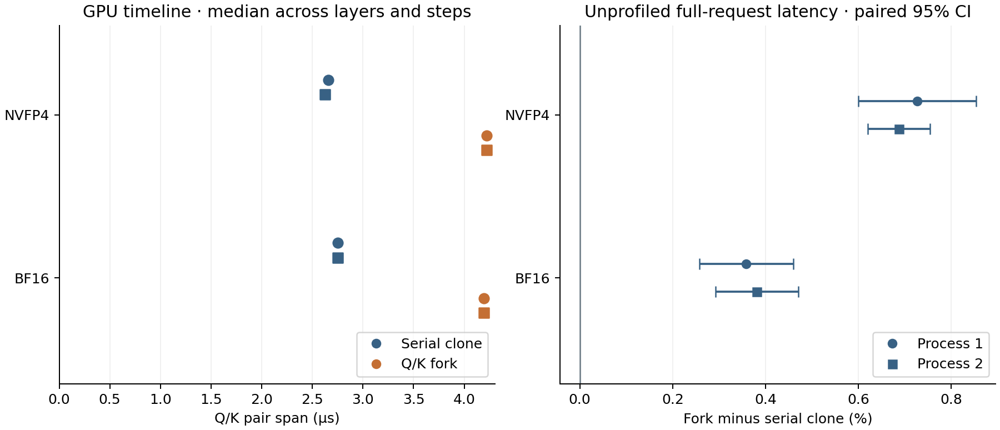

# 两个有真实消费者的 Q/K Kernel 并发后，Qwen3 Decode 变快了吗？

在北交 RTX 5090 上，本轮选择了每步、每层原本就要完成的工作。Qwen3 的 Q 和 K 各自经过 RMSNorm 及 RoPE。Q 交给 Attention，K 写入 KV Cache。用同一个已捕获模型 Graph 构造两个克隆，一个保留原顺序，一个只放开 Q/K 之间的顺序依赖。实验没有新增计算，使用的权重、激活、CUDA Kernel 和后续消费者相同。[实现与依赖检查](src/branches.py)

**结论：Q/K 可以可靠并行，但这个实现使 NVFP4 和 BF16 的完整推理都变慢。** 这给上一轮留下的两个问题提供了实测对照。第一，真实推理任务确有可以并发的必要工作。第二，收益取决于放开依赖后三个时长如何变化：两个分支各自的运行时间，以及它们重叠的时间。

## 从完整模型核验生产者与消费者

- 研究范围是 E2、本地 vLLM 贪心生成，使用 8 条不同的 2,048-token 输入、257 个输出、256 次实际 Decode，以及共享的 FP8 KV 格式。研究窗口为已经分词的请求进入本地模型到生成返回，未计在线网络、客户端分词或排队。
- 两种精度分别在现场根据 Q/K Norm 权重地址、Graph 节点及函数参数识别全部 36 层。两分支使用同一 QKV 输入、位置和 RoPE 缓存，读取各自 Norm 权重，写入独立的输出区间。实际 K 输出命中 KV 写入函数第 0 个参数，Q 输出命中 Attention 第 4 个参数（均从 0 计数）。本机生成的 Triton 源码中，对应函数读取四个输入指针，只向输出指针写入。所有正式试次逐请求输出 Token Hash 与各精度的历史基线一致。中间浮点张量未做全量逐位对照。[编译来源](analysis/source_audit.json) · [运行清单](analysis/inventory.csv)
- 两种克隆的依赖共同约束后续 KV 写入，Attention 原有的特殊依赖属性得以保留。原始 Graph、顺序克隆和并行克隆的每个模型节点经过完整名字、Grid/Block、寄存器和共享内存签名核对。NVFP4 每次重放 505 个 Kernel，BF16 每次重放 397 个。[逐步 GPU 执行区间](raw/)

## GPU 实际发生了什么

四个独立 P2 进程，每进程运行一次完整请求组。256 次 Decode 按三种模式交错，四份时间线合计覆盖 36,864 对实际 Q/K 执行。下表列各独立进程的观测，所有微秒数据取对应模式下所有层与步骤的中位数。串行为顺序克隆。联合区间从两个 Kernel 中最早的开始计至最晚的结束。[节点汇总](analysis/p2_summary.csv) · [临近三步的成对变化](analysis/p2_triplets.csv)

| 精度与进程 | 串行 Q / K（µs） | 并行 Q / K（µs） | 两者重叠（µs） | 联合区间串行 → 并行（µs） | QKV 结束到 KV 写入开始，串行 → 并行（µs） |
|---|---:|---:|---:|---:|---:|
| NVFP4，第 1 次 | 1.248 / 1.248 | 1.664 / 4.096 | 1.536 | 2.657 → 4.224 | 3.040 → 4.577 |
| NVFP4，第 2 次 | 1.248 / 1.248 | 1.664 / 4.096 | 1.536 | 2.625 → 4.224 | 3.040 → 4.608 |
| BF16，第 1 次 | 1.280 / 1.280 | 1.888 / 4.064 | 1.760 | 2.752 → 4.192 | 3.104 → 4.544 |
| BF16，第 2 次 | 1.280 / 1.280 | 1.888 / 4.064 | 1.760 | 2.752 → 4.192 | 3.104 → 4.576 |

并行配置中 **12,312/12,312** 对 Q/K 在不同 CUDA 流上发生真实 GPU 时间重叠。原图和顺序克隆的 **24,552** 对均无重叠。进入时间足够早：并行 K 相对 Q 的起点约晚 0.13 µs。代价集中在 K 的运行区间，其持续时间从约 1.25–1.28 µs 增至 4.06–4.10 µs；Q 也稍长。把 36 层加起来，同一组连续三个 Decode 步内，NVFP4 的 Q/K 联合区间增加中位数为 58.5–58.6 µs，BF16 约 51.8–52.7 µs，时间已传到原 KV 消费者。[逐步观测](analysis/p2_steps.csv) · [成对对照](analysis/p2_triplets.csv)

实际 Q 与 K 的 Grid 分别是 32 和 8 个 CTA，每 CTA 64 线程，每线程分别占用 96 和 102 个寄存器，静态和动态共享内存均为 0 B。两种精度的这组资源配置相同。哪怕两者总 CTA 数小于本机 170 个 SM，短 Kernel 的并行机会也可能因运行时长增长而带来额外代价。当前没有 CTA 的实际 SM 位置记录。[逐层 launch 元数据](analysis/launch_resources.csv)

## 无 Profiling 的完整请求结果

各精度两次独立模型进程，每个进程五个配对块。每块真实执行原图、顺序克隆和并行克隆各一次，三者各自的完整请求都执行 9,216 对 Q/K。共 **60 次完整八请求推理**。下表以并行减顺序克隆表示延迟变化，正数为变慢。区间是每个进程内五个块的描述性 95% t 区间，独立进程分别报告。TPOT 按请求计算，ITL 按单个请求相邻输出时间计算。[逐次数据](analysis/p0_trials.csv) · [配对估计](analysis/p0_estimates.csv)

| 精度与进程 | 模型延迟增加 ms | 模型延迟变化与 95% 区间 | TPOT 增加 ms/token | 逐请求 ITL 的 P95 增加 ms |
|---|---:|---:|---:|---:|
| NVFP4，r1 | +15.57 | +0.73% [0.60, 0.85]% | +0.058 | +0.061 |
| NVFP4，r2 | +14.65 | +0.69% [0.62, 0.75]% | +0.058 | +0.078 |
| BF16，r1 | +14.63 | +0.36% [0.26, 0.46]% | +0.059 | +0.086 |
| BF16，r2 | +15.53 | +0.38% [0.29, 0.47]% | +0.056 | +0.058 |

四个进程相对顺序克隆的完整模型延迟均上升，进程内五块形成的区间均高于零。直接以原 Graph 为对照，NVFP4 两次分别慢 0.73% 和 0.65%，BF16 分别慢 0.41% 和 0.37%。两种精度都增加约 15 ms。相似的绝对代价落在时长不同的模型上，产生了不同的百分比；单凭这一百分比不能判定 FP4 的执行管线竞争更大。

**Amdahl 量级核对。** 若 Q 与 K 能同时启动，且各自保持原串行时长，每层最多省掉两者中较短一项和原有间隙。用 P2 每步 36 层的实测值外推 256 步，理想节约约为 NVFP4 12.7 ms（0.59%–0.60%）、BF16 13.3 ms（约 0.33%）。真正放开依赖之后，改用实际的联合时长变化外推，方向反转，NVFP4 增加 14.9–15.1 ms，BF16 增加 13.3–13.5 ms，与独立 P0 完整请求观测同向且量级相近。P0 与 P2 来自不同进程，外推不能作为逐请求因果分解。[占比计算](analysis/whole_request_scale.csv)

## 对资源利用研究的意义

1. **已验证（VERIFIED）**。这项工作有真实生产者和消费者，四份 P2 中的并行模式均在 GPU 时间线上充分重叠，所有受测模型输出正确。完整推理的 P0 对照可直接检验这项执行策略的收益。四个进程分别对比空克隆及原始 Graph，可以区分克隆路径和改变依赖的影响。
2. **局部原因已定位，微架构原因待定（PARTIALLY_SUPPORTED）**。在 P2 内能直接观测到 K 的持续时间增加，Q 也有所增长。K 已很快进入 GPU，两个分支均完成后原消费者才启动。因此这次放置失败可以定位到重叠期间分支执行时间变长。GPU Trace 的起止时间包含调度和执行影响。数据尚不能拆出指令发射、缓存、SM 驻留或设备内部跨流调度各占多少，也未取得逐 CTA 的 SM 位置证据。
3. **适用边界**。这次测试的两个分支均是 BF16 激活上的 Q/K 处理，周围投影才因模型精度发生变化。不能由此概括其他算子或其他并发策略。尤其不能推翻上轮在 NVFP4 Down 旁放置固定 Tensor 工作的时间线结果，两轮的额外工作、进入位置及持续时间均不同。[上轮精确放置实验](../gate4_targeted/final_report.md)
4. **研究取舍**。对这个 E2 形状，可以排除“把原有两个短 Q/K Kernel 直接放到并行分支”作为加速实现。值得保留的判据是对照真实消费者的到达时间，并核查拿掉串行依赖后单个任务自身的时长变化。若想把该对照用于新精度或新形状，应先验证执行分支、有效工作量和时间占比。

首个 NVFP4 尝试停在暖机时的边属性检查，未计入性能结果；随后只放宽对原样保留的 KV→Attention 边的读取，修改的 Q/K 边仍逐一验证。P2 用于实际 GPU 区间，P0 用于正式延迟。P2 按步混排，P0 按完整请求固定，缺少完全同条件的逐配置 profiler 扰动率。全体成功和失败记录、硬超时监督日志、工作进程源码版本均已保留。原始 SQLite 与 NSYS 报告保存在实验服务器，仓库保留路径和校验和。[运行状态](analysis/supervision.csv) · [遥测](analysis/telemetry.csv) · [复现说明](README.md)
