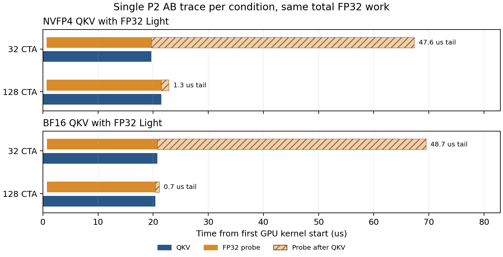

# QKV 与 FP32 探针的 32/128 CTA 对照

在相同 FP32 工作量下，32 CTA 把 NVFP4 QKV 的平均时长增幅降到 **1.6%–3.2%**，但两项任务联合完成平均多用 **44–45 µs**。GPU 时间线显示，大约 **48 µs** 的辅助任务发生在 QKV 结束之后。

## 固定工作量和测量方式

继续使用第 18 层真实 QKV 权重、同一 BF16 合成激活和已验收的单节点 Graph。FP32 Light 的二进制、每 CTA 32 线程、65536 个逻辑项、8 轮计算、输入输出字节数及 16777216 FLOP 保持一致。改变 Grid 后，每个 CTA 以 grid-stride 方式处理不同数量的逻辑分组。每个 worker 的两个 Grid 使用相同的探针输入、输出缓冲区和同一个 QKV Graph。

22:41–22:42 对两种精度各采一份 32 CTA 的 NSYS 诊断。重新从已归档的 128 CTA P2 Trace 提取同口径的 Kernel 区间与尾部。22:43:03–22:45:48 完成六个无 Profiling 的跨精度配对块。每块分别启动 BF16、NVFP4 进程，平衡精度先后并交替测试 Grid 顺序。12 个独立进程共完成 216 条计时条件，每条执行前均有对应预热，所有输出验证通过。串行 AB/BA 实际执行并完成相同工作量。[运行清单](analysis/p0_grid_set_20261118_144301_utc.json) · [P0 运行库存](analysis/qkv_grid_p0_run_inventory.csv)

## P0 主任务干扰与联合完成时间

主任务增幅相对同块同 Grid 的 A Alone。联合完成时间由共同放行到两侧任务完成。表内为六块均值，区间为块级 t 置信区间。AB 和 BA 表示两种提交顺序。

| 精度 | 探针 Grid | AB：QKV 时长增幅 [95% CI] | BA：QKV 时长增幅 [95% CI] | AB / BA 联合时长 |
| --- | ---: | ---: | ---: | ---: |
| NVFP4 | 32 | 3.22% [−3.48%, 9.92%] | 1.63% [−0.61%, 3.88%] | 79.77 / 79.16 µs |
| NVFP4 | 128 | 10.91% [7.87%, 13.95%] | 11.71% [7.92%, 15.49%] | 35.32 / 34.57 µs |
| BF16 | 32 | 0.73% [0.06%, 1.40%] | 0.62% [−1.67%, 2.92%] | 83.64 / 82.21 µs |
| BF16 | 128 | 1.34% [−4.09%, 6.77%] | 0.70% [−5.53%, 6.92%] | 33.72 / 34.31 µs |

NVFP4 在同进程同提交顺序下，32 CTA 相比 128 CTA 的损失低 7.69 个百分点（AB，95% CI [−15.32, −0.06]）和 10.07 个百分点（BA，[−14.54, −5.61]）。32 CTA 的 BA 顺序在本轮区间内低于 5% 预算。AB 的区间上界达 9.92%，其中块 1 测到 +16.17%，该点保留。BF16 的两个跨 Grid 差异区间都跨零。[逐条件计时](analysis/qkv_grid_p0_conditions.csv) · [配对统计](analysis/qkv_grid_p0_statistics.csv)

NVFP4 的 32 CTA 探针保留了约 97% 的同 Grid 单独吞吐，高于 128 CTA 的约 75%–76%。32 CTA 自身的单独基线较慢，故吞吐保持率更高时，绝对联合完成时间仍增长约 44–45 µs。同工作量相对各自实测串行仍有收益，NVFP4 为 32 CTA 下 1.26–1.27×、128 CTA 下 1.47–1.54×。[逐块数据](analysis/qkv_grid_p0_block_metrics.csv)

## P2 实际时间重叠与尾部

| 精度 | 探针 Grid | 与 QKV 重叠的探针执行时间占比 | QKV 结束后的探针尾部 |
| --- | ---: | ---: | ---: |
| NVFP4 | 32 | 28.55%–28.58% | 47.58–47.65 µs |
| NVFP4 | 128 | 93.94%–94.23% | 1.28–1.34 µs |
| BF16 | 32 | 29.10%–29.61% | 48.38–48.74 µs |
| BF16 | 128 | 96.38%–97.76% | 0.48–0.74 µs |

这里的重叠分母是 **B 的整个 Kernel 时长**。以较短 Kernel 为分母时，32 CTA 仍可得到约 96.3%–96.6% 的重叠比，因为 QKV 基本被较长的探针覆盖。该比值无法反映 B 的长尾。所有 B 的全量输出都正确，但没有 CTA 进度数据可把 28%–30% 的时间占比转换成已完成 FLOP 占比。四类负对照在两份新 Trace 中仍为零重叠。[32 CTA 实际区间](analysis/grid32_trace/qkv_pilot_intervals.csv) · [128 CTA 实际区间](analysis/grid128_trace/qkv_pilot_intervals.csv)

当前 32 CTA 是主任务延迟与辅助完成时间之间的取舍。若辅助结果必须在这次 QKV 结束前可用，两档在已采集的时间线中都未达到该条件，32 CTA 尾部尤其长。若消费者在更晚的真实算子上，需要进一步测量尾部与后续算子的竞争。当前结果来自固定输入的单层诊断，每份时间线只有一个 P2 块。无法据此确定同 SM 共驻、具体竞争管线或完整推理收益。后续可按原 Grid 扫描计划选 64 CTA 做中间点，判断能否同时约束主任务干扰和辅助工作截止时间。
