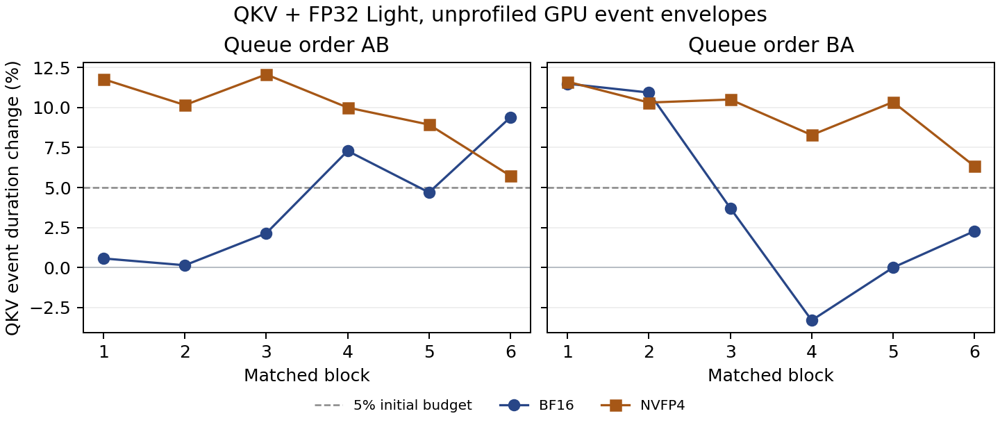

# 真实 QKV 的无 Profiling 配对复测

六个配对块验证了首轮试点的主要现象。RTX 5090 上，128 CTA 的 FP32 Light 探针使 NVFP4 QKV 的 GPU Event 时长平均增加约 **9.6%–9.8%**。两个提交顺序的 95% 区间下界都超过拟用的 5% 预算。BF16 的点估计约 4%，两种精度的配对差异仍有不确定性。

## 实际运行

北京时间 2026-11-18 22:32:34–22:35:23 完成六个配对块。每块使用两个独立 GPU worker，BF16 与 NVFP4 的精度先后顺序在块间平衡。总计 12 个不同进程、108 条计时记录。每个进程保留九个条件各一次不计入统计的预热，再用固定种子打乱正式执行顺序。每次检查实际完成任务与全量输出，全部通过。监督器逐次确认没有外部计算进程，最后一组结束后确认 GPU 已释放。[固定顺序及运行路径](analysis/p0_set_20261118_143232_utc.json) · [运行库存与设备记录](analysis/qkv_p0_run_inventory.csv)

A 使用与 [P2 试点](report.md) 相同的第 18 层单节点 QKV，保持真实 checkpoint 权重、8×4096 合成激活、原函数及启动属性。B 使用实测校准过的 FP32 Light，128 CTA、32 threads/CTA、65536 个逻辑项和 8 轮计算，每次完成 16777216 FLOP。A Alone、B Alone、实测 Serial AB/BA、Parallel AB/BA 和三种控制条件全部保留。在每种精度和每个块内，串行与并发完成相同 A+B 工作量。

P0 运行不用 NSYS、NCU 或 NVTX。用设备标志在两个分支提交后统一放行，记录各分支的 CUDA Event 包络与共同放行至两个分支完成的联合包络。前置填充和输出回读在计时区间外。A Alone 的 Event 时长中位数分别为 NVFP4 20.448 µs、BF16 22.512 µs。Event 包络适用于同协议下的性能对照，含分支派发与执行等待。本轮的重叠事实来自先前独立的 P2 时间线，未把 P2 Kernel 区间混入 P0 统计。[逐条件原始计时](analysis/qkv_p0_conditions.csv)

## 同工作量结果

表内为六个块的均值。A 增幅以同块的 A Alone 为分母，B 吞吐保持率以同块的 B Alone 为基准，联合收益对比同顺序的实测串行。95% 区间采用块级 t 区间，并假设本设备上各块效应独立。

| 精度 | 提交顺序 | A 时长增幅及 95% 区间 | B 吞吐保持率 | 同工作量联合收益 |
| --- | --- | ---: | ---: | ---: |
| NVFP4 | AB | 9.78% [7.36%, 12.19%] | 75.47% | 1.472× |
| NVFP4 | BA | 9.57% [7.56%, 11.58%] | 75.48% | 1.476× |
| BF16 | AB | 4.04% [0.10%, 7.98%] | 78.23% | 1.539× |
| BF16 | BA | 4.19% [−2.05%, 10.42%] | 75.92% | 1.526× |

NVFP4 减 BF16 的块内差异为 AB **+5.74 个百分点**，95% 区间 [−0.30, +11.78]。BA 为 **+5.38 个百分点**，区间 [+0.02, +10.74]。AB 的区间跨零，BA 的下界接近零。这说明在当前配置下，NVFP4 的点估计更不利，两种提交顺序合起来仍不足以断言精度差异稳定。BF16 的两个区间上界都超过 5%，也未通过“可重复低于 5%”的准入标准。[逐块指标](analysis/qkv_p0_block_metrics.csv) · [统计与区间](analysis/qkv_p0_statistics.csv)

## 对研究问题的影响

当前配置同时出现了联合工作更快、NVFP4 主任务超出预算、FP32 探针吞吐下降三个现象。前一轮约 15% 的基于 P2 Kernel 区间的增幅，在 P0 Event 口径下表现为约 10% 的损失。两轮均观察到主任务受到干扰，无法从这两个不同计时口径分离 Profiling 扰动的大小。

P0 是单层合成激活诊断，相同权重和缓冲区多次复用，L2 命中率和 CTA 位置没有测量。SM 时钟和功耗来自粗粒度监督快照，覆盖空闲、初始化和活动状态，无法分配给微秒级 Kernel。Grid、单函数 Occupancy 和之前的高重叠率均不足以确定哪个共享资源引发干扰。联合收益反映两项工作的完工时间，完整 LLM 推理收益仍待验证。

下一轮保持同一真实 QKV 和探针程序，改变探针 Grid，并分别通过 P2 看真实开始/结束区间和 P0 对比主任务干扰。原定 32 CTA 与 128 CTA 对照保持逻辑任务量相等。已有校准表明 32 CTA 的相同 8 轮工作运行约 65 µs，明显长于 QKV。分析时需要单独报告 A 完成后的 B 尾部，再决定是否引入等时长的补充对照。Gate/Up、Tensor Probe、同 SM 映射和完整推理仍是后续验收范围。
