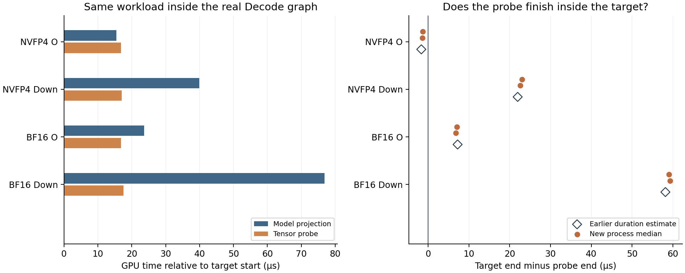
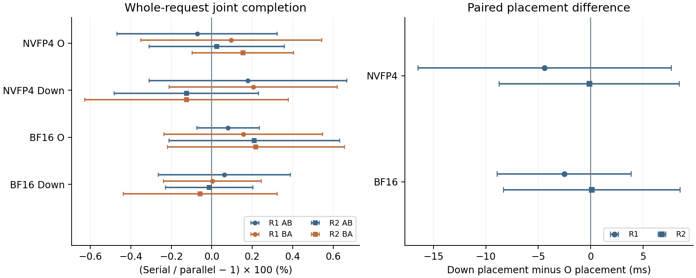

# 第 18 层 O 与 Down 能否容纳同一项 Tensor 工作

2026 年 11 月 19 日，在北交共享 RTX 5090 上运行了真实 Qwen3-8B 自回归推理。**NVFP4 的 O 和 FFN Down 都发射 32 个 CTA。相同探针放在 O 旁边时，8 次都晚于 O 结束；放在 Down 旁边时，8 次都在 Down 结束前完成。BF16 的两个投影都能容纳它。** 两种精度各有两次独立进程时间线。这个结果可以确定工作放置的时间边界，同时留下了不同的问题：换一个位置，究竟能让完整请求快多少？[逐事件观测](analysis/p2_nodes.csv)

## 一、为什么把探针放在这两个具体节点

前一轮在历史完整模型时间线上看到，第 18 层 NVFP4 的 O 约 15 µs，Down 约 39 µs，独立 BF16 Tensor 辅助 Kernel 约 16–17 µs。早先从 Decode Graph 入口注入的探针碰到的是其他模型节点，无法检验 O 和 Down 的预测。这次保留完整模型，在两个投影的直接前驱就绪时允许探针启动，投影的直接后继等待探针完成。另做同位置、两种先后顺序的强制串行、原图以及空克隆对照。[前一轮资源画像](../gate4_microarch/final_report.md) · [Graph 依赖与复现方法](README.md)

两种精度使用相同的 8 条 2,048-token 输入、FP8 E4M3 KV、关闭前缀缓存和贪心生成。每条实际产生 257 个输出，执行 256 次 Decode。只在第 33–64 步、索引 18 的一层注入。每个 B 是 64 CTA 的 BF16 MMA，有 65,536 个输出逐项校验。所有请求的输出 Hash 都与各自精度的历史原始模型一致。探针输出有数值校验，模型后续算子并不读取这些输出。[运行核查](analysis/run_inventory.csv) · [原始推理记录](raw/)

## 二、哪种投影真正容得下探针

下表的余量为 GPU 时间戳上的“投影结束减探针结束”。正值表示探针提前完成。各次探针的开始均在目标投影开始之后。每种精度有两份独立 NSYS Node Trace，每份中每个并行位置测四次。同一进程内重复反映步骤变化。

| 模型投影 | 事前预计余量 µs | 第一次实测中位数 µs | 独立复测中位数 µs | 完全落在投影内 | 辅助执行时间被覆盖 |
|---|---:|---:|---:|---:|---:|
| NVFP4 O | −1.66 | −1.38 | −1.33 | 0/8 | 91.6%–92.3% |
| NVFP4 Down | +21.95 | +22.59 | +22.98 | 8/8 | 100% |
| BF16 O | +7.23 | +6.80 | +7.02 | 8/8 | 100% |
| BF16 Down | +58.16 | +59.28 | +59.06 | 8/8 | 100% |

四种组合均有 8/8 次 GPU 执行区间重叠。64 次串行注入中，实测的两个 Kernel 顺序全部符合各自依赖，交集均为零。所有 128 次被检查的 Replay 中，NVFP4 每次有 505 个原模型 Kernel，BF16 有 397 个。每次仅按条件增加零或一个 B。GPU UUID、exec ID、local node ID、模块权重绑定以及逐次 launch 签名共同确定了目标。两种精度分别在同一输入下重现了自己的原模型输出。[预测复核](analysis/forecast_check.csv) · [逐次 Trace](analysis/p2_nodes.csv)

这组数据可以解释预测为何有效。实测 B 相对 A 的 GPU 起点只晚 0.128–0.160 µs（各进程中位数），执行时间也在相近量级。NVFP4 的 O 在并发时持续 15.63–16.05 µs，B 持续 16.80–17.07 µs；Down 则持续 39.17–39.57 µs，B 持续 16.27–16.45 µs。两次复测和四种组合的预测符号全部一致，进程中位数的最大绝对预测误差为 1.12 µs。这个误差只适用于预先选定的四种组合。历史 NVFP4 Gate/Up 的探针晚约 46.6 µs 才进入，说明推广时还必须测量辅助工作的进入延迟。[进程级时长与相对吞吐](analysis/p2_summary.csv) · [Gate/Up 的独立证据](../gate4_microarch/final_report.md)

即使 B 全部落在投影内，B 自己也可能因竞争变慢。以实际串行 AB 内的 B Kernel 吞吐为基准，BF16 Down 并发时 B 保留约 90.5%，NVFP4 Down 为 97.0%–99.6%。局部串行 AB 与并行的 A/B 联合区间之比，在 NVFP4 O 上为 1.81–1.83，在 NVFP4 Down 上为 1.41–1.44。O 接近两项等长工作，Down 本身比 B 长，因此“是否完全覆盖”与“局部联合加速比”给出不同的排序。这是 P2 节点区间的描述。[局部指标与分母](analysis/p2_summary.csv)

## 三、局部差异能否传到完整推理

无 Profiling 共运行 **160 次完整 E2 请求组**。每种精度有两个独立模型进程，每进程五个配对块，每块包含八种模式的全部对照。每个激活探针的请求组注入 32 次，完成 8,589,934,592 逻辑 FLOP。模型窗口截止于本地生成返回，联合窗口还包括统一的输出记录核对和 GPU drain。下表差值为同一块中“放在 Down 的联合时间减去放在 O 的联合时间”；负值表示 Down 更快。区间为各进程内五个配对差值的描述性 95% t 区间。[逐次 P0](analysis/p0_trials.csv) · [配对估计](analysis/p0_summary.csv)

| 精度与独立进程 | 原生完整模型时间中位数 | Down 减 O，均值 [95% 区间] | Down 并发相对空克隆的模型时间变化 | Down 串行 AB / 并发联合时间 |
|---|---:|---:|---:|---:|
| NVFP4，第一次 | 2163.17 ms | −4.39 [−16.48, +7.71] ms | −0.131% | 1.00178× |
| NVFP4，复测 | 2165.30 ms | −0.13 [−8.72, +8.47] ms | −0.169% | 0.99875× |
| BF16，第一次 | 4086.80 ms | −2.51 [−8.91, +3.89] ms | −0.068% | 1.00062× |
| BF16，复测 | 4087.37 ms | +0.12 [−8.30, +8.53] ms | −0.015% | 0.99987× |

四组 Down 减 O 的区间都跨过零。在四组合计十六个“同位置、同工作量的串行 AB 或 BA / 并行”估计中，进程内 95% 区间均跨过 1。模型时间相对空克隆的八个估计均接近零。逐请求注入步 ITL 的 P95 也有波动，例如 BF16 O 的第一次为 −1.16% [−1.96%, −0.36%]，独立复测为 −0.07% [−1.18%, +1.04%]。现有样本无法分辨这么小的完整请求收益，不能据此宣称两个策略严格等效。P2 的各步混排和 P0 的每请求固定模式不同，未拿 P2 的墙钟时间推算 P0 加速或精确的分析器扰动率。[逐块差值](analysis/paired_blocks.csv)

**按实际占比，高估收益的空间可以算清。** P2 串行条件中，探针单次 GPU 执行约 16 µs。若串行执行的 B 都在关键路径，其他成本固定，32 次完全隐藏共可节省约 0.50–0.52 ms，相当于 NVFP4 完整模型窗口约 0.024%，BF16 约 0.012%。更具体地说，NVFP4 把探针从 O 换到 Down，仅按避免 O 尾部计算，量级为 32 × 1.33–1.38 µs ≈ **0.043–0.044 ms，约占请求 0.002%**。这些是以中位数推算的工作量和理想贡献，Graph 边依赖、进入开销和相邻节点的变化仍会影响实际完成时间。[逐进程占比计算](analysis/request_scale.csv)

## 四、这个结果如何约束优化方向

**已验证（VERIFIED）**。在本机、E2、Greedy、索引 18、64 CTA BF16 Tensor 探针和指定 32 步下，两种精度均支持节点级时间重叠。NVFP4 Down 完全覆盖探针，O 则有稳定的尾部。两者 CTA 数相等，使用 Grid 大小作为唯一选窗变量会漏掉这个差异。BF16 O 和 Down 都能容纳探针，因此这项能力在该负载上也见于 BF16。

**部分支持（PARTIALLY_SUPPORTED）**。历史 NCU 所见的单 CTA 资源压力，加上本轮实测的进入时间与覆盖，支持用“主 Kernel 覆盖范围、窗口时长、探针进入延迟和竞争中执行时间”共同筛选目标。活跃 SM 上 Tensor 管线很忙，整卡仍可能容纳额外工作。当前缺直接 CTA 所在 SM 的记录，探针究竟用了哪些 SM 仍未确定。[寄存器、驻留、Warp 和缓存的前轮对照](../gate4_microarch/analysis/projection_comparison.csv)

**尚未验证（UNVERIFIED）**。人工探针没有推理消费者。此实验没有测量在线吞吐、额外工作的可用率随负载改变的曲线、Prefill 或其他层的放置收益。两种放置的模型级差异仍受此次实验的分辨率限制。一个决定是否值得进一步研究的量，是实际推理中有多少必要工作能够在输入就绪后进入这些窗口、并从原来的关键路径上移除。把其他 35 层或其余 224 步简单乘进上界，会暗含数据依赖、截止时间和竞争条件处处相同的假设。

| 用户关心的资源 | 本轮补上的证据 | 仍缺的因果证据 |
|---|---|---|
| Tensor / FP32、Warp 与 Stall | 前轮已取得 8 个真实投影的诊断 NCU，本轮在完整模型验证一项固定 Tensor 工作的实际进入和完成时机 | 其他探针强度、FP32/INT 压力和其他阶段的可迁移性 |
| SM、寄存器、共享内存 | 相同 NVFP4 主 CTA 规模可以产生不同的完整覆盖结果 | 异类 CTA 的实际 SM 位置，寄存器与共享内存压力的独立干预 |
| L1/L2/DRAM | 前轮有缓存条件对照、读取 sector 与显存探针数据，本轮沿用真实模型原有节点和访问顺序 | 并发时 A/B 各自的物理读流量，以及完整模型内的缓存瓶颈因果归属 |
| 资源竞争与时序 | 四种目标各有独立进程复测，GPU 时间线与无 Profiling 模型延迟分开测量 | 更宽负载范围、真实下游消费者和可重复的服务收益 |

所有实验按单次授权时限执行，共享 GPU 监督器按次核查设备并记录进程、温度、功耗和时钟。遥测包含进程启动和退出阶段，未作为某个微秒节点的工作频率。原始二进制 Trace 保存在服务器，仓库内有大小与校验值。[运行与遥测](analysis/supervision.csv) · [原始数据与 Trace 索引](raw/)
