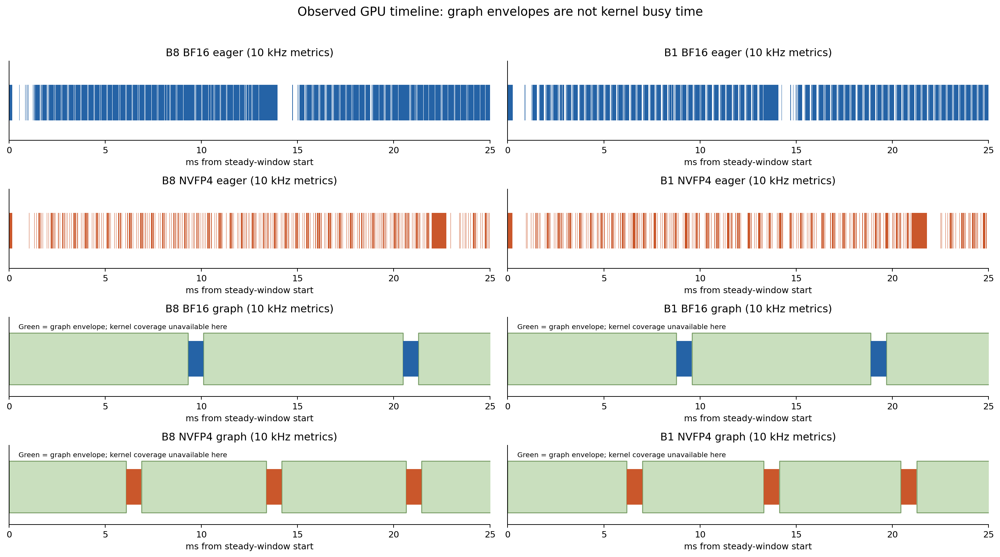
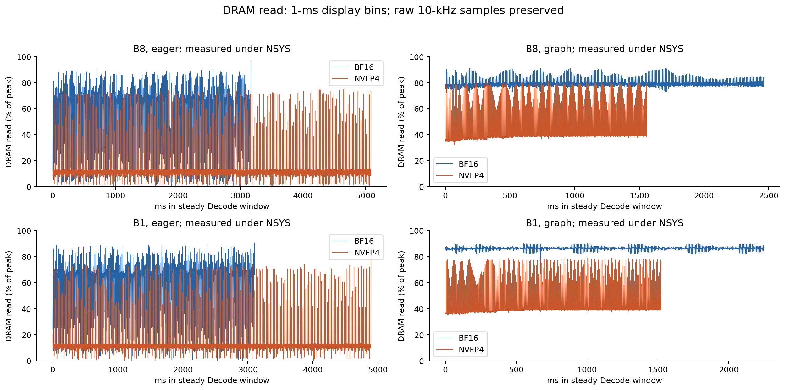
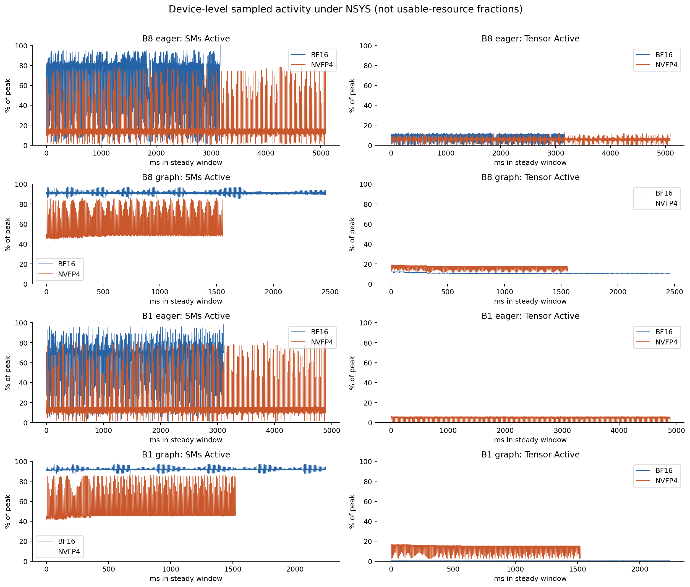
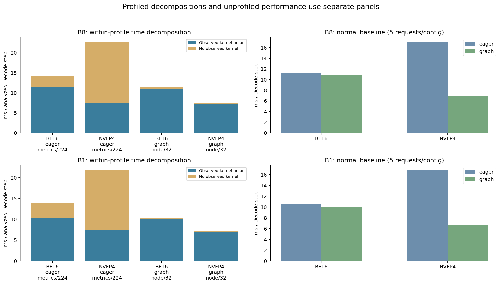

# RTX 5090 原生 NVFP4 vs BF16：NSYS GPU Metrics 第二轮报告

整理时间：2026-11-16T21:45:18+08:00。服务器产物目录：`~/fp4-llm/results/nsys_round2/`。

## 结论与证据等级

本轮把实际请求的无 Profiling 性能、NSYS 时间线和设备级 GPU Metrics 分开测量。当前配置已经观察到 BF16/NVFP4 的资源使用差异，但**没有证明低利用率可以转化为安全、有效的辅助计算容量**。

| 假设 | 判断 | 证据与限制 |
| --- | --- | --- |
| H1：BF16 Decode 的 DRAM 使用高于 NVFP4 | **已验证，限定本次 Graph 采样条件；Eager 为初步支持** | Graph 有独立进程复测、真实设备映射及稳态窗口；比较的是设备级时间平均，不是单 Kernel 的专属吞吐，也不是完整模型每步 DRAM 字节。 |
| H2：FP4 Kernel 缩短后，Eager 间隔比例增大 | **初步支持** | 同样 NSYS 条件下，FP4 的观测 Kernel 并集占比更低；但 Eager 的 CUDA 时间线采集本身显著增加延迟，不能把该间隔比例直接当正常运行比例。 |
| H3：Graph 减少执行间隔并改善 FP4 性能 | **性能部分已验证；间隔的因果解释为初步支持** | 每配置五次真实请求测量及实际 Replay 记录支持性能改善；Graph 路径同时涉及正常编译/融合、异步调度和 Replay，不能把全部差额归于 Graph Launch 单一机制。 |

下面的“已验证”只对应本机、指定模型与测试条件。基线五次请求在同一个已加载模型进程中执行；不是五次独立模型初始化。Graph Metrics 的 r02/r03 是独立进程采集。Eager 正式 Metrics 只保留一轮，不用反复采集来制造高置信度。

### 关键数据速览

下表性能列来自无 Profiling 基线；资源列来自两次独立 Graph＋10 kHz 采集的稳态均值范围。两类测量没有混算成加速比。

| Batch | 精度 | 正常Graph ms/步 | DRAM Read均值 % | SMs Active均值 % | Tensor Active均值 % |
| --- | --- | --- | --- | --- | --- |
| 8 | bf16 | 10.962 | 79.26–79.33 | 90.99–91.03 | 10.74–10.75 |
| 8 | nvfp4 | 6.880 | 44.04–44.06 | 53.56–53.57 | 16.84–16.86 |
| 1 | bf16 | 10.024 | 86.41–86.41 | 91.77–91.77 | 0.37–0.37 |
| 1 | nvfp4 | 6.725 | 44.19–44.36 | 51.18–51.30 | 13.55–13.62 |

一个具体的执行路径差异是：32步Node记录中，BF16 Batch=1的Linear为cuBLAS `internal::gemvx::kernel`族，共4640次（含lm_head）；Batch=8则记录到BF16 WMMA TensorOp族，共4640次。NVFP4在两个Batch中都记录到4608次SM120 E2M1 GEMM，对应每步144个量化Linear，另保留未量化lm_head。**不能假定BF16和FP4在所有小M上使用同类Tensor Core数据流。** Batch=1时BF16 Tensor Active很低、FP4反而更高，与上述执行族差异相符；这里没有凭Kernel名称推断未检查的完整SASS或所有CUDA Core指令。

## 1. 完成范围与执行记录

- 8 个核心配置：Batch 1/8 × BF16/NVFP4 × Eager/Graph，每配置 5 次无 Profiling 基线。
- Batch=8 先完成小规模采集、设备/时间验证，再进行正式基线与采集；随后扩展 Batch=1。
- 各核心配置分别采集仅 CUDA/NVTX 时间线和时间线＋10 kHz Metrics；Graph 另做独立 Metrics 复测、32 步 Node 级短窗口。
- 没有运行 NCU、辅助 Kernel、Kernel 优化、时钟调整或功率调整。
- 每个 GPU 作业启动前检查 `nvidia-smi -q`、`gpu-who`、计算进程与已知自动启动控制器；运行时每约 2 秒检查计算进程，有硬超时。未抢占或终止其他用户进程。
- 全命令和显式环境变量见 `commands.txt`；逐次 pre/post-check、运行输出及监督状态见 `logs/`。
- 未覆盖历史实验报告。原始 `.nsys-rep`、SQLite、逐步输出 JSON 均保留。

**诊断控制组不混入正式基线。** 最初为逐步计时试用了 `async_scheduling=False`；它明显改变延迟，因此 r01 的四个同步调度基线只保留在 `analysis/baseline_sync_diagnostic.csv`。正式脚本恢复历史默认异步调度，原脚本归档为 `scripts/decode_round2_sync_diagnostic.py`，正式原始 JSON 标记 `protocol=default_scheduler_v2`。

一次 Graph pilot 在 NSYS 结束时，目标 Python 短暂被重新托管，监督器曾把它误判为“新计算任务”。原始 PID 与该 pilot JSON/Trace 中的自身 PID 一致；没有其他用户任务。已在 CPU 侧定位并改为保留已登记的后代 PID；保留原日志，pilot 不作为正式性能结果。未因该误报重新运行模型。

## 2. 环境与固定工作负载

| 项目 | 设置 |
| --- | --- |
| GPU | RTX 5090 / GB202 / SM120，170 SM，32 GB；UUID `022c5f55-490e-ec54-3887-5f12510d273d`，PCI `0000:27:00.0` |
| 软件 | vLLM 0.33.0、torch 2.14.0+cu132、FlashInfer 0.7.2.post1、NSYS 2026.1.3.425；系统工具链 CUDA 13.3，驱动报告 CUDA 13.2 |
| 模型 | 本地 Qwen3-8B-BF16 / Qwen3-8B-NVFP4；沿用已校验的模型 |
| 提示词 | 固定 2048 个 Token ID：`1000 + i % 5000`，全文见 `input_token_ids.json` |
| Batch | 1 或 8；8 个真实活跃请求，逐步调度记录检查实际 Batch，未用固定形状 bench forward 替代 |
| KV | 两种精度均为 `fp8_e4m3`；上下文随 AR 解码自然增长，并非每步冻结为 2048 |
| Attention | 显式固定 FLASHINFER；运行日志记录 XQA Decode、BF16 Query 与 FP8 KV |
| Linear | 两边统一 `linear_backend=cutlass`；NVFP4 的运行时 Kernel 记录包含 SM120 block-scaled E2M1 模板 |
| 调度 | 同进程 `InprocClient`，`VLLM_ENABLE_V1_MULTIPROCESSING=0`；正式数据使用默认异步调度 |
| 其他 | max_model_len=4096、max_num_batched_tokens=8192、max_num_seqs=8、gpu_memory_utilization=0.85、Graph capture sizes=[1,8]、seed=0 |
| 采样 | temperature=0、ignore_eos=True；每请求 257 个输出 token：首个由 prefill 产生，随后 256 个实际 Decode Step |

这是**离线 `LLM.generate` 真实请求的 CPU＋GPU Decode 计时**，包含当前进程的 EngineCore 调度与输出处理；不包含 HTTP、网络、完整服务排队或首个 prefill。不是在线服务吞吐基准。

两边固定提示 Token ID；生成 token 由各自模型预测，未强制为同一轨迹。原始 JSON 保存输出长度、生成序列 SHA256、逐步实际 Batch 与 scheduled tokens。Batch=8 的请求使用同样提示，启用了 prefix caching，因此其 KV 具有共享前缀局部性；不能推广为八条完全无关请求。

每进程先预热两次 33-token 生成。正式窗口在第一次真实 Decode 被调度、前置 GPU 工作完成后开始；只在窗口边界 synchronize，未逐步额外同步。Step P50/P95 使用 CPU 接收到完整批次输出进度的时间间隔；异步流水下它不是单个 GPU Kernel 的服务时延。脚本保留少量相同的 CPU/NVTX 观测 hook，其开销未单独消融。

## 3. 无 Profiling 正式基线

无 NSYS、NCU 或 torch.profiler。下表各项为五次请求测量的中位数；“256步墙钟”排除首个 prefill，Tokens/s 计算 `Batch×256 / Decode墙钟`。每次请求实际执行到 257 个输出 token，调度记录确认其中 256 次为单 token Decode。

| Batch | 精度 | 模式 | 请求重复 | 256步墙钟 ms | 平均步 ms | P50步 ms | P95步 ms | 输出 tokens/s |
| --- | --- | --- | --- | --- | --- | --- | --- | --- |
| 8 | bf16 | eager | 5 | 2891.390 | 11.294 | 11.199 | 11.455 | 708.3 |
| 8 | bf16 | graph | 5 | 2806.155 | 10.962 | 10.951 | 11.610 | 729.8 |
| 8 | nvfp4 | eager | 5 | 4374.372 | 17.087 | 17.038 | 17.316 | 468.2 |
| 8 | nvfp4 | graph | 5 | 1761.330 | 6.880 | 6.884 | 7.491 | 1162.8 |
| 1 | bf16 | eager | 5 | 2709.317 | 10.583 | 10.558 | 10.707 | 94.5 |
| 1 | bf16 | graph | 5 | 2566.262 | 10.024 | 9.980 | 10.674 | 99.8 |
| 1 | nvfp4 | eager | 5 | 4319.291 | 16.872 | 16.862 | 17.123 | 59.3 |
| 1 | nvfp4 | graph | 5 | 1721.672 | 6.725 | 6.716 | 7.293 | 148.7 |

完整逐次数据见 `baseline.csv`，逐步时延见 `analysis/decode_step_stats.csv`。显存、SM clock、功耗和温度保存在 `analysis/hardware_telemetry.csv`，原始 `nvidia-smi -q` 在监督日志中。遥测约每两秒一次，包含初始化/预热，不能冒充每个 Decode Step 的硬件状态。

### Graph 相对 Eager 的实际性能

| Batch | 精度 | Eager ms/步 | Graph ms/步 | 加速比 E/G | 延迟降低 |
| --- | --- | --- | --- | --- | --- |
| 8 | bf16 | 11.294 | 10.962 | 1.030× | 2.95% |
| 8 | nvfp4 | 17.087 | 6.880 | 2.484× | 59.74% |
| 1 | bf16 | 10.583 | 10.024 | 1.056× | 5.28% |
| 1 | nvfp4 | 16.872 | 6.725 | 2.509× | 60.14% |

Eager Graph Launch 数为 0；正式 Graph Capture 日志、Python Replay 计数与 SQLite `cudaGraphLaunch` 均检查过，每次正式窗口记录 256 次 Replay，实际 Batch 与指定值一致。没有把 `enforce_eager=False` 本身当作实际启用的证据。

## 4. Profiling 扰动：必须先看此表

| Batch | 精度 | 模式 | 采集 | 步数 | 采集 ms/步 | 基线 ms/步 | 相对基线 |
| --- | --- | --- | --- | --- | --- | --- | --- |
| 1 | bf16 | eager | metrics | 256 | 13.862 | 10.583 | 30.98% |
| 1 | bf16 | eager | timeline | 256 | 13.659 | 10.583 | 29.07% |
| 1 | bf16 | graph | metrics | 256 | 10.053 | 10.024 | 0.29% |
| 1 | bf16 | graph | metrics | 256 | 10.053 | 10.024 | 0.28% |
| 1 | bf16 | graph | node | 32 | 10.235 | 10.024 | 不同长度，不作比值 |
| 1 | bf16 | graph | timeline | 256 | 10.067 | 10.024 | 0.42% |
| 8 | bf16 | eager | metrics | 256 | 14.142 | 11.294 | 25.21% |
| 8 | bf16 | eager | timeline | 256 | 14.054 | 11.294 | 24.43% |
| 8 | bf16 | graph | metrics | 256 | 11.030 | 10.962 | 0.63% |
| 8 | bf16 | graph | metrics | 256 | 11.043 | 10.962 | 0.74% |
| 8 | bf16 | graph | node | 32 | 11.356 | 10.962 | 不同长度，不作比值 |
| 8 | bf16 | graph | timeline | 256 | 11.020 | 10.962 | 0.54% |
| 1 | nvfp4 | eager | metrics | 256 | 21.851 | 16.872 | 29.51% |
| 1 | nvfp4 | eager | timeline | 256 | 22.803 | 16.872 | 35.15% |
| 1 | nvfp4 | graph | metrics | 256 | 6.842 | 6.725 | 1.73% |
| 1 | nvfp4 | graph | metrics | 256 | 6.857 | 6.725 | 1.96% |
| 1 | nvfp4 | graph | node | 32 | 7.297 | 6.725 | 不同长度，不作比值 |
| 1 | nvfp4 | graph | timeline | 256 | 6.825 | 6.725 | 1.48% |
| 8 | nvfp4 | eager | metrics | 256 | 22.749 | 17.087 | 33.13% |
| 8 | nvfp4 | eager | timeline | 256 | 21.759 | 17.087 | 27.34% |
| 8 | nvfp4 | graph | metrics | 256 | 6.983 | 6.880 | 1.50% |
| 8 | nvfp4 | graph | metrics | 256 | 6.990 | 6.880 | 1.59% |
| 8 | nvfp4 | graph | node | 32 | 7.441 | 6.880 | 不同长度，不作比值 |
| 8 | nvfp4 | graph | timeline | 256 | 7.005 | 6.880 | 1.82% |

Eager 的主要扰动来自 CUDA 时间线跟踪本身；10 kHz Metrics 的增量应与同配置 timeline 比较。Graph 级采集影响较小。发现 Eager 扰动后，相关数据降为采样条件下的诊断，不用于估计正常推理的精确间隔；没有提高到 20 kHz 或反复重跑该路径来强行确认正常时序。其余采集用于完成有/无 Metrics 的扰动定位及低开销 Graph 对照。

Node 级只有 32 步，未与 256 步基线计算精确扰动比；它用于执行组成与观测 Kernel 覆盖。**不将 Node Profiling 耗时与未 Profiling 的 Eager 耗时直接计算加速。**

## 5. 时间戳与设备身份核查

1. 先通过实际 Schema 确认：`GPU_METRICS.timestamp`、CUPTI `start/end`、NVTX `start/end` 使用 Trace 的 ns 时间；全程没有使用 rawTimestamp 过滤 Kernel，也没有自行添加偏移。
2. `GENERIC_EVENT_SOURCES.timeSourceId` 对应本机枚举的 `SessionNs`；GPU Metrics、Kernel/Graph 和 Decode NVTX 的范围相交。窗口前 SM/Tensor 活动低、进入 Decode 后上升，与时间线对应。
3. 采集入口的设备 0 已由 NSYS help 映射到指定 PCI 地址；再通过 GPU inventory UUID 与 `TARGET_INFO_CUDA_DEVICE` 的 UUID/进程关系确认是同一设备。没有只凭两个索引都为 0 判断身份。
4. EngineCore 使用 InprocClient，GPU Kernel 所属 CUDA 进程与脚本 PID 对应；标记没有停留在一个不执行 CUDA 的父进程。
5. 历史数据实测采样间隔约 1 ms，历史启动脚本也显式设置了 1000 Hz；因此旧 1 kHz 是实际采集设置。历史“过滤后只剩约31%采样点”本身不证明时钟错位，与约29%观测覆盖可以相容。

详见 `analysis/timestamp_validation.json` 和逐 Trace validation JSON，其中保留 Schema、范围、UUID、采样统计及 Diagnostics。

### 10 kHz 实际采样质量

| 配置 | 重复 | 整段样本数 | 间隔P50 μs | 间隔P95 μs | 最大间隔 μs | >1.5×中位间隔数量 |
| --- | --- | --- | --- | --- | --- | --- |
| B8 bf16 eager | r02 | 37374 | 100.004 | 100.036 | 100.036 | 0 |
| B8 bf16 graph | r02 | 29105 | 99.988 | 100.020 | 100.021 | 0 |
| B8 bf16 graph | r03 | 29194 | 99.994 | 100.026 | 100.026 | 0 |
| B8 nvfp4 eager | r02 | 59502 | 99.986 | 100.018 | 100.019 | 0 |
| B8 nvfp4 graph | r02 | 18876 | 99.989 | 100.022 | 100.022 | 0 |
| B8 nvfp4 graph | r03 | 18846 | 99.995 | 100.027 | 100.027 | 0 |
| B1 bf16 eager | r02 | 36556 | 99.999 | 100.031 | 100.031 | 0 |
| B1 bf16 graph | r02 | 26488 | 99.999 | 100.032 | 100.032 | 0 |
| B1 bf16 graph | r03 | 26801 | 100.000 | 100.032 | 100.032 | 0 |
| B1 nvfp4 eager | r02 | 57326 | 99.999 | 100.031 | 100.032 | 0 |
| B1 nvfp4 graph | r02 | 18407 | 100.000 | 100.032 | 100.032 | 0 |
| B1 nvfp4 graph | r03 | 18314 | 100.000 | 100.032 | 100.032 | 0 |

未观察到指标采样间隔缺口或 Buffer Overflow/Missing Data 诊断。NSYS 保留了 capture 边界相关的 “Not all NVTX/CUDA events might have been collected” 警告；不能把“无 overflow”写成工具绝对完整性证明。目标 Decode 标记、Replay 数及主要 Kernel 计数的对应关系用于检查目标窗口。

GPC/SYS Frequency 在 SQLite 中出现负数或远超合理 MHz 范围的值，均标为无效，未取绝对值、未猜测换算比例。该频率字段不参与推理；硬件 clock 另保留 `nvidia-smi` 遥测。

正式采集为 256 步；稳态指标和主要覆盖统计使用输出完成标记之间的 **第17–240步，共224步**，剔除开始/结束各16步。32步 Node 诊断不作该裁剪。性能扰动对照仍使用完整256步原始墙钟，不能混用两个分母。

## 6. 设备级指标：稳态窗口统计

所有百分比均沿用 NSYS 指标名的 `% of peak`，不换算成 FLOPs。下表同时提供全窗口均值/P50/P95/峰值；峰值只作参考。Graph 级 Trace 无完整 Node 活动时，活跃/间隔均值留空。Eager/Node 的活跃分类按采样点 timestamp 与观测 Kernel 并集相交，100 μs 采样不能变成单个短 Kernel 的专属计数器。

| 配置 | 重复 | 指标 | 全窗均值 | P50 | P95 | 峰值 | 有效样本 | 活跃点均值 | 间隔点均值 |
| --- | --- | --- | --- | --- | --- | --- | --- | --- | --- |
| B8 bf16 eager | r02 | SMs Active | 72.667 | 82.000 | 100.000 | 100.000 | 31682 | 79.955 | 41.979 |
| B8 bf16 eager | r02 | SM Issue | 4.892 | 5.000 | 8.000 | 9.000 | 31682 | 5.248 | 3.392 |
| B8 bf16 eager | r02 | Tensor Active | 9.487 | 10.000 | 13.000 | 14.000 | 31682 | 10.376 | 5.743 |
| B8 bf16 eager | r02 | DRAM Read Bandwidth | 61.695 | 70.000 | 96.000 | 97.000 | 31682 | 67.568 | 36.966 |
| B8 bf16 eager | r02 | DRAM Write Bandwidth | 0.917 | 1.000 | 1.000 | 1.000 | 31682 | 0.993 | 0.595 |
| B8 bf16 eager | r02 | Compute Warps in Flight | 5.167 | 4.000 | 10.000 | 15.000 | 31682 | 5.444 | 4.000 |
| B8 bf16 graph | r02 | SMs Active | 91.032 | 94.000 | 100.000 | 100.000 | 24617 | — | — |
| B8 bf16 graph | r02 | SM Issue | 5.641 | 5.000 | 8.000 | 9.000 | 24617 | — | — |
| B8 bf16 graph | r02 | Tensor Active | 10.752 | 11.000 | 13.000 | 15.000 | 24617 | — | — |
| B8 bf16 graph | r02 | DRAM Read Bandwidth | 79.326 | 80.000 | 96.000 | 97.000 | 24617 | — | — |
| B8 bf16 graph | r02 | DRAM Write Bandwidth | 0.999 | 1.000 | 1.000 | 1.000 | 24617 | — | — |
| B8 bf16 graph | r02 | Compute Warps in Flight | 6.410 | 6.000 | 10.000 | 14.000 | 24617 | — | — |
| B8 bf16 graph | r03 | SMs Active | 90.994 | 94.000 | 100.000 | 100.000 | 24639 | — | — |
| B8 bf16 graph | r03 | SM Issue | 5.634 | 5.000 | 8.000 | 9.000 | 24639 | — | — |
| B8 bf16 graph | r03 | Tensor Active | 10.736 | 11.000 | 13.000 | 15.000 | 24639 | — | — |
| B8 bf16 graph | r03 | DRAM Read Bandwidth | 79.257 | 81.000 | 96.000 | 97.000 | 24639 | — | — |
| B8 bf16 graph | r03 | DRAM Write Bandwidth | 0.998 | 1.000 | 1.000 | 1.000 | 24639 | — | — |
| B8 bf16 graph | r03 | Compute Warps in Flight | 6.428 | 6.000 | 10.000 | 25.000 | 24639 | — | — |
| B8 nvfp4 eager | r02 | SMs Active | 16.552 | 9.000 | 53.000 | 100.000 | 50892 | 22.326 | 13.651 |
| B8 nvfp4 eager | r02 | SM Issue | 2.520 | 2.000 | 6.000 | 6.000 | 50892 | 2.674 | 2.443 |
| B8 nvfp4 eager | r02 | Tensor Active | 5.828 | 5.000 | 15.000 | 18.000 | 50892 | 7.734 | 4.871 |
| B8 nvfp4 eager | r02 | DRAM Read Bandwidth | 13.572 | 7.000 | 33.000 | 97.000 | 50892 | 22.062 | 9.306 |
| B8 nvfp4 eager | r02 | DRAM Write Bandwidth | 0.589 | 1.000 | 1.000 | 2.000 | 50892 | 0.833 | 0.466 |
| B8 nvfp4 eager | r02 | Compute Warps in Flight | 3.122 | 2.000 | 10.000 | 20.000 | 50892 | 3.712 | 2.826 |
| B8 nvfp4 graph | r02 | SMs Active | 53.558 | 54.000 | 100.000 | 100.000 | 15568 | — | — |
| B8 nvfp4 graph | r02 | SM Issue | 6.688 | 7.000 | 9.000 | 10.000 | 15568 | — | — |
| B8 nvfp4 graph | r02 | Tensor Active | 16.856 | 17.000 | 20.000 | 23.000 | 15568 | — | — |
| B8 nvfp4 graph | r02 | DRAM Read Bandwidth | 44.043 | 40.000 | 96.000 | 97.000 | 15568 | — | — |
| B8 nvfp4 graph | r02 | DRAM Write Bandwidth | 0.997 | 1.000 | 1.000 | 7.000 | 15568 | — | — |
| B8 nvfp4 graph | r02 | Compute Warps in Flight | 10.299 | 10.000 | 15.000 | 15.000 | 15568 | — | — |
| B8 nvfp4 graph | r03 | SMs Active | 53.570 | 54.000 | 100.000 | 100.000 | 15560 | — | — |
| B8 nvfp4 graph | r03 | SM Issue | 6.687 | 7.000 | 9.000 | 10.000 | 15560 | — | — |
| B8 nvfp4 graph | r03 | Tensor Active | 16.840 | 17.000 | 20.000 | 23.000 | 15560 | — | — |
| B8 nvfp4 graph | r03 | DRAM Read Bandwidth | 44.059 | 40.000 | 97.000 | 97.000 | 15560 | — | — |
| B8 nvfp4 graph | r03 | DRAM Write Bandwidth | 0.997 | 1.000 | 1.000 | 1.000 | 15560 | — | — |
| B8 nvfp4 graph | r03 | Compute Warps in Flight | 10.297 | 10.000 | 15.000 | 15.000 | 15560 | — | — |
| B1 bf16 eager | r02 | SMs Active | 66.373 | 77.000 | 100.000 | 100.000 | 31016 | 74.417 | 43.491 |
| B1 bf16 eager | r02 | SM Issue | 9.022 | 10.000 | 14.000 | 15.000 | 31016 | 10.038 | 6.132 |
| B1 bf16 eager | r02 | Tensor Active | 0.272 | 0.000 | 1.000 | 1.000 | 31016 | 0.249 | 0.340 |
| B1 bf16 eager | r02 | DRAM Read Bandwidth | 62.656 | 74.000 | 96.000 | 97.000 | 31016 | 70.228 | 41.117 |
| B1 bf16 eager | r02 | DRAM Write Bandwidth | 0.770 | 1.000 | 1.000 | 1.000 | 31016 | 0.797 | 0.695 |
| B1 bf16 eager | r02 | Compute Warps in Flight | 15.792 | 18.000 | 25.000 | 25.000 | 31016 | 17.662 | 10.470 |
| B1 bf16 graph | r02 | SMs Active | 91.770 | 94.000 | 100.000 | 100.000 | 22465 | — | — |
| B1 bf16 graph | r02 | SM Issue | 10.589 | 11.000 | 12.000 | 14.000 | 22465 | — | — |
| B1 bf16 graph | r02 | Tensor Active | 0.374 | 0.000 | 1.000 | 1.000 | 22465 | — | — |
| B1 bf16 graph | r02 | DRAM Read Bandwidth | 86.411 | 88.000 | 97.000 | 97.000 | 22465 | — | — |
| B1 bf16 graph | r02 | DRAM Write Bandwidth | 0.911 | 1.000 | 1.000 | 7.000 | 22465 | — | — |
| B1 bf16 graph | r02 | Compute Warps in Flight | 21.898 | 22.000 | 25.000 | 25.000 | 22465 | — | — |
| B1 bf16 graph | r03 | SMs Active | 91.768 | 94.000 | 100.000 | 100.000 | 22471 | — | — |
| B1 bf16 graph | r03 | SM Issue | 10.602 | 11.000 | 12.000 | 14.000 | 22471 | — | — |
| B1 bf16 graph | r03 | Tensor Active | 0.373 | 0.000 | 1.000 | 1.000 | 22471 | — | — |
| B1 bf16 graph | r03 | DRAM Read Bandwidth | 86.410 | 88.000 | 97.000 | 97.000 | 22471 | — | — |
| B1 bf16 graph | r03 | DRAM Write Bandwidth | 0.901 | 1.000 | 1.000 | 1.000 | 22471 | — | — |
| B1 bf16 graph | r03 | Compute Warps in Flight | 21.901 | 22.000 | 25.000 | 25.000 | 22471 | — | — |
| B1 nvfp4 eager | r02 | SMs Active | 16.346 | 5.000 | 56.000 | 100.000 | 48933 | 24.082 | 12.310 |
| B1 nvfp4 eager | r02 | SM Issue | 2.099 | 1.000 | 5.000 | 15.000 | 48933 | 3.183 | 1.534 |
| B1 nvfp4 eager | r02 | Tensor Active | 4.785 | 2.000 | 16.000 | 18.000 | 48933 | 6.796 | 3.735 |
| B1 nvfp4 eager | r02 | DRAM Read Bandwidth | 13.935 | 8.000 | 36.000 | 93.000 | 48933 | 23.330 | 9.033 |
| B1 nvfp4 eager | r02 | DRAM Write Bandwidth | 0.546 | 1.000 | 1.000 | 2.000 | 48933 | 0.775 | 0.427 |
| B1 nvfp4 eager | r02 | Compute Warps in Flight | 3.730 | 1.000 | 12.000 | 25.000 | 48933 | 5.488 | 2.812 |
| B1 nvfp4 graph | r02 | SMs Active | 51.300 | 52.000 | 100.000 | 100.000 | 15237 | — | — |
| B1 nvfp4 graph | r02 | SM Issue | 5.378 | 5.000 | 10.000 | 12.000 | 15237 | — | — |
| B1 nvfp4 graph | r02 | Tensor Active | 13.545 | 15.000 | 18.000 | 20.000 | 15237 | — | — |
| B1 nvfp4 graph | r02 | DRAM Read Bandwidth | 44.357 | 40.000 | 92.000 | 93.000 | 15237 | — | — |
| B1 nvfp4 graph | r02 | DRAM Write Bandwidth | 0.921 | 1.000 | 1.000 | 1.000 | 15237 | — | — |
| B1 nvfp4 graph | r02 | Compute Warps in Flight | 11.258 | 11.000 | 25.000 | 25.000 | 15237 | — | — |
| B1 nvfp4 graph | r03 | SMs Active | 51.177 | 52.000 | 100.000 | 100.000 | 15295 | — | — |
| B1 nvfp4 graph | r03 | SM Issue | 5.408 | 5.000 | 10.000 | 12.000 | 15295 | — | — |
| B1 nvfp4 graph | r03 | Tensor Active | 13.617 | 15.000 | 19.000 | 20.000 | 15295 | — | — |
| B1 nvfp4 graph | r03 | DRAM Read Bandwidth | 44.191 | 40.000 | 92.000 | 93.000 | 15295 | — | — |
| B1 nvfp4 graph | r03 | DRAM Write Bandwidth | 0.922 | 1.000 | 1.000 | 1.000 | 15295 | — | — |
| B1 nvfp4 graph | r03 | Compute Warps in Flight | 11.238 | 11.000 | 25.000 | 25.000 | 15295 | — | — |

活跃/间隔的各类有效采样数、无效采样数保存在 `analysis/metric_summary.csv`。原始设备样本见 `analysis/metric_samples.csv`，所有指标还保留在逐 Trace metrics CSV。

## 7. Kernel 时间并集与间隔

逐设备、逐目标窗口裁剪区间后排序合并。`T_active` 是观测 Kernel 区间并集；`T_gap=T_window−T_active`。该比例称为 **Kernel time coverage**，不称为 SM 利用率，也不把间隔全归因于 CPU。

| 配置 | 采集/窗口 | 分析步数 | 窗口 ms | Kernel并集 ms | 无观测Kernel ms | 覆盖率 | Kernel记录数 |
| --- | --- | --- | --- | --- | --- | --- | --- |
| B8 bf16 eager | metrics/224 | 224 | 3168.567 | 2558.973 | 609.594 | 80.76% | 101263 |
| B8 bf16 graph | node/32 | 32 | 363.410 | 354.519 | 8.891 | 97.55% | 13250 |
| B8 nvfp4 eager | metrics/224 | 224 | 5088.982 | 1700.456 | 3388.526 | 33.41% | 133519 |
| B8 nvfp4 graph | node/32 | 32 | 238.129 | 229.466 | 8.662 | 96.36% | 16706 |
| B1 bf16 eager | metrics/224 | 224 | 3101.779 | 2295.199 | 806.580 | 74.00% | 101263 |
| B1 bf16 graph | node/32 | 32 | 327.520 | 319.940 | 7.580 | 97.69% | 13250 |
| B1 nvfp4 eager | metrics/224 | 224 | 4893.616 | 1667.105 | 3226.511 | 34.07% | 133519 |
| B1 nvfp4 graph | node/32 | 32 | 233.580 | 224.760 | 8.819 | 96.22% | 16706 |

Graph 级 Trace 中的 `CUPTI_ACTIVITY_KIND_GRAPH_TRACE` 仅为 Graph 外包络，内部可能有空隙，因此该类正式256步采集的 Kernel Coverage 标为不可可靠计算。图4中的 Graph 分解来自单独32步 Node Trace，不能回填到低开销 Graph 级运行。

### 与 CPU Launch/同步的关系

| 配置 | 总间隔 ms | 与Launch API重叠 ms | 与同步API重叠 ms | 单间隔P50 μs | P95 μs |
| --- | --- | --- | --- | --- | --- |
| B8 bf16 eager | 609.594 | 113.724 | 0.014 | 0.256 | 24.608 |
| B8 bf16 graph | 8.891 | 0.610 | 2.786 | 0.192 | 0.448 |
| B8 nvfp4 eager | 3388.526 | 532.661 | 0.000 | 21.853 | 71.958 |
| B8 nvfp4 graph | 8.662 | 0.806 | 2.907 | 0.192 | 0.416 |
| B1 bf16 eager | 806.580 | 142.311 | 0.000 | 0.256 | 31.261 |
| B1 bf16 graph | 7.580 | 0.549 | 2.694 | 0.192 | 0.448 |
| B1 nvfp4 eager | 3226.511 | 534.627 | 0.000 | 20.319 | 71.392 |
| B1 nvfp4 graph | 8.819 | 0.825 | 3.001 | 0.192 | 0.448 |

这些是**时间重叠关联**，不是已证明的因果份额；Launch 与同步可能重叠，不能把两列直接相加。CPU_SCHEDULER NVTX 与 CUDA Runtime correlationId 提供调用证据，但没有 OS context-switch 采样或完整依赖停顿证据，剩余部分保持“未归因”。不能由 `window−kernel_union` 得出“CPU造成了全部等待”。

### 运行时原生 NVFP4 路径证据

| 配置 | 重复 | 观测SM120 E2M1 GEMM次数 | 分析步数 | 进程映射一致 |
| --- | --- | --- | --- | --- |
| B8 nvfp4 eager | r02 | 32256 | 224 | True |
| B8 nvfp4 eager | r02 | 32256 | 224 | True |
| B8 nvfp4 graph | r02 | 4608 | 32 | True |
| B1 nvfp4 eager | r02 | 32256 | 224 | True |
| B1 nvfp4 eager | r02 | 32256 | 224 | True |
| B1 nvfp4 graph | r02 | 4608 | 32 | True |

完整 Kernel 名保存在逐 Trace summary JSON，包含 `SM120_16x8x64_TN_VS`、`float_e2m1_t` 与 block-scaled CUTLASS 类型；该证据来自实际运行，而非只检查二进制里存在某个符号。本轮未使用 NCU，也没有据此声称取得动态 MMA 指令计数。

## 8. 四张核心图

图1分开画 Graph 外包络和观测 Kernel；图中空白仅描述对应 Trace，不能泛化成可插入任务的空间。

图2展示1 ms显示分箱均值；原始10 kHz数据保留。横轴是实际 Trace 时间，各次运行长度不同。

图4左侧在各自 Profiling 窗口内分解，右侧单独给出无 Profiling 基线；不混算两类时间。

## 9. 对任务书八个问题的回答

1. **稳定 Decode 时间是多少？【已验证，限本配置五次请求重复】** 见第3节，每种模式保留平均步时延、P50/P95及所有原始重复；不使用最优一次作为正式结果。
2. **Graph 对两种精度提升多少？【性能部分已验证】** 见第3节，FP4 的默认 Graph 路径改善明显更大；单独 Graph、编译融合与调度各自的因果贡献未消融。
3. **BF16 DRAM 是否长期接近峰值？【初步支持较高平均使用；无法确认持续饱和】** Graph 稳态均值/P95比单个87%峰值更有意义，但不足以证明唯一瓶颈。Eager 空隙会稀释设备均值。
4. **FP4 DRAM 使用是否降低？【已验证，限Graph设备级统计】** 本次两个Batch的重复采集直接比较；不将此等同于每个Kernel服务速率降低，或宣称剩余带宽可以无干扰复用。
5. **Tensor/SM 有何差异？【已验证，限采样条件】** 见第6节；FP4可出现更低SM活跃而更高Tensor Active。不同格式下指标不是统一的剩余FLOPs比例。
6. **多少间隔可归因CPU？【无法给出确定份额】** 第7节只给Launch/同步时间重叠及未归因部分。Eager tracing改变时间分布，不能声称其余百分比全在等CPU。
7. **Profiling是否改变现象？【已验证存在扰动】** Eager CUDA tracing的延迟增加明显；Metrics增量和Graph级采集分别对照。Eager数据只作受扰条件下的现象，不用来定量描述正常间隔。
8. **是否证明FP4有可利用硬件余量？【无法判断】** 没有辅助任务准入、共驻留、干扰或兑现收益实验；此轮按任务书不做这些实验。只能确认资源画像与执行组织不同。

## 10. 未完成、未验证及适用边界

- 没有20 kHz采集：10 kHz已满足设备级稳态统计，不为追求更高频率增加扰动；仍不能解析每个数十微秒Kernel的独占资源使用。
- 没有为Eager构造零扰动的完整Kernel时间线；其正常运行Coverage和严格CPU因果份额仍无法判断。该项不能靠再跑同样的Trace解决。
- 没有完整在线服务请求混合、跨模型、跨GPU或模型准确率评估。
- FP8 KV加载日志仍有scale dtype/默认1.0警告。本轮保持既有配置并记录，不据此宣称质量等价，也未改动checkpoint或scale。
- 两个模型同时改变权重/激活数值与执行实现；这不是只更改权重位宽的单变量实验。
- 实际Kernel资源准入（寄存器、SMEM、CTA驻留）和另一个任务能否利用余量，留给后续决策。本轮数据不自动授权下一轮并发实验。

## 11. 文件索引与复核入口

`environment.txt` / `environment_check_report.md`：NSYS本机帮助、支持集合、历史Schema核查；`commands.txt`：完整启动命令与环境；`baseline.csv`：正式性能基线；`raw/`：JSON及nsys-rep；`sqlite/`：原始导出；`analysis/`：验证、设备样本、区间、步时延、指标统计及扰动表；`figures/`：PNG和SVG。

实验脚本位于 `~/fp4-llm/scripts/decode_round2.py`、`run_one.py`、`run_plan.py`、`validate_trace.py`、`analyze_round2.py`、`collect_bundle.py`。脚本SHA256和数据清点保存在 `analysis/report_data.json` 与 `analysis/artifact_manifest.json`。
