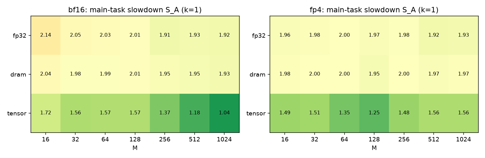
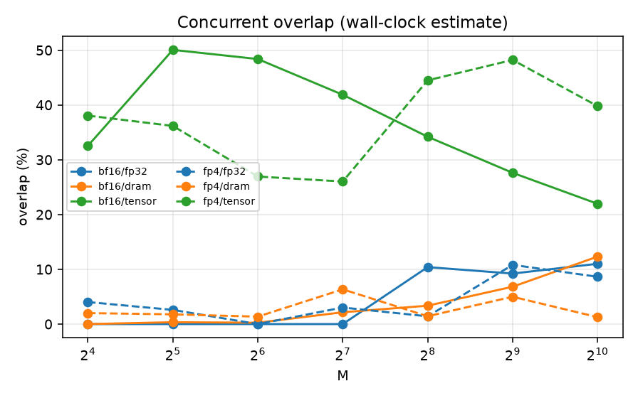
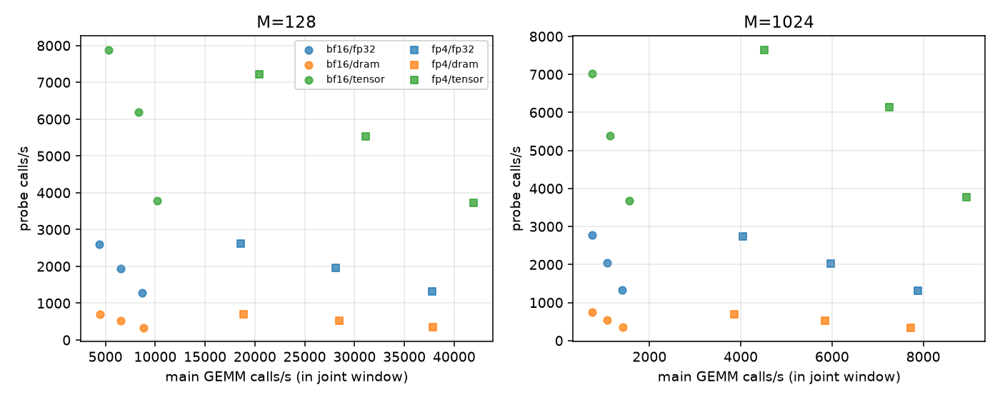

# M1 首轮：BF16 与原生 NVFP4 的硬件资源差异（实测）

> ## ⚠️ 本报告的部分结论已撤回（见 audit_v3）
>
> 以下条目**不可再引用**，原因见 [`../audit_v3/source_audit.md`](../audit_v3/source_audit.md)：
> - 所有 `S_A` / `S_B` / `G` 的绝对值 —— 旧协议的设备端起跑偏差达 4.5–23 ms（实测）
> - 所有 `overlap %`（FP32 4.4% / DRAM 3.2% / tensor 36.9%）—— 那是墙钟派生量，不是物理重叠
> - "FP32/DRAM 探针无余量" —— 探针本身不纯（`torch.add` / `torch.sum`）
> - "M≈256 交叉点" —— 未在修正协议下重测
> - "BF16 峰值 51% ⇒ 一半 tensor core 空闲" —— 利用率不等于可回收资源
>
> 修正版见 [`../audit_v3/corrected_results.md`](../audit_v3/corrected_results.md)。
> 仍然有效：单任务吞吐表、原生 FP4 指令证据、六阶段数值验收。

日期：2026-11-14　平台：云容器 RTX 5090（驱动 590.44.01 / CUDA 13.1 / torch 2.12.1+cu130），**独占空闲**
工具：CUDA Events + 双流 + `nvidia-smi` 采样 + `cuobjdump` — **全程未使用 NCU**

> 结论先行：**两者在标量算力与 DRAM 带宽上没有可回收差异；唯一的差异在 tensor pipe，
> 而且"谁有余量"会随 batch 翻转。** 这就是本课题可以站得住脚的切入点。

---

## 1. 吞吐：同一逻辑 GEMM 的算力上限（N=12288, K=4096）

| M | BF16 时间 | BF16 TFLOPS | FP4 时间 | FP4 TFLOPS | 加速比 |
|---:|---:|---:|---:|---:|---:|
| 16 | 33.1 µs | 48.6 | 30.3 µs | 53.2 | 1.09× |
| 128 | 76.4 µs | 168.6 | 19.9 µs | 646.7 | 3.84× |
| 512 | 249.6 µs | 206.5 | 53.4 µs | 965.4 | 4.68× |
| 1024 | 484.9 µs | **212.6** | 89.2 µs | **1156.0** | **5.44×** |

- BF16 实测封顶 **212.6 TFLOPS** = 理论 419 的 **50.7%**
- FP4 实测封顶 **1156.0 TFLOPS** = 理论 1676 的 **69.0%**
- **比值 5.44×，而不是理论上的 4×**：FP4 kernel 的指令效率更高（每指令 4× MAC、操作数字节 1/4）

**关键：加速比随 M 单调增长（1.09× → 5.44×）。** 小 M 时两者都被权重流量限制
（BF16 权重 96 MiB ≈ L2 96 MiB；FP4 只有 24 MiB 可全驻留），算力优势被掩盖。

## 2. 干扰矩阵：谁真的在抢资源（等时长，k=1，3 会话中位数）

主任务减速 `S_A = T_A_conc / T_A_alone`：

| M | 精度 | FP32 FMA 探针 | DRAM 流式探针 | **Tensor MMA 探针** |
|---:|---|---:|---:|---:|
| 16 | BF16 | 2.13 | 2.03 | 1.73 |
| 16 | FP4 | 1.96 | 1.99 | **1.50** |
| 128 | BF16 | 2.01 | 2.00 | 1.57 |
| 128 | FP4 | 2.00 | 1.99 | **1.35** |
| 1024 | BF16 | 1.91 | 1.89 | **1.04** |
| 1024 | FP4 | 1.93 | 2.01 | **1.56** |

探针自身减速 `S_B`（越 >1 说明探针被主任务挤压）：

| M | 精度 | FP32 | DRAM | Tensor |
|---:|---|---:|---:|---:|
| 16 | BF16 | 1.11 | 1.05 | 1.07 |
| 16 | FP4 | 1.07 | 1.02 | 1.15 |
| 128 | BF16 | 1.14 | 1.05 | 1.37 |
| 128 | FP4 | 1.08 | 1.02 | 1.02 |
| 1024 | BF16 | 1.36 | 1.39 | 1.85 |
| 1024 | FP4 | 1.26 | 1.09 | 1.46 |

并发总时收益 `G = T_serial / T_joint`（>1 才有意义）：

| M | 精度 | FP32 | DRAM | Tensor |
|---:|---|---:|---:|---:|
| 16 | BF16 | 0.96 | 0.99 | 1.16 |
| 16 | FP4 | 1.02 | 1.01 | 1.22 |
| 128 | BF16 | 1.00 | 1.01 | 1.25 |
| 128 | FP4 | 0.99 | 1.00 | 1.11 |
| 1024 | BF16 | 1.05 | 1.05 | 1.08 |
| 1024 | FP4 | 1.03 | 1.01 | 1.25 |

## 3. 四条发现

**F1｜标量与带宽：没有差异，量化不产生余量。**
FP32 与 DRAM 探针的 S_A 在两种精度上几乎完全重合（2.0 / 2.0 / 1.9）。
把权重压到 4-bit **并没有**让标量流水或内存带宽变空——主任务该占的照样占满。
这条是重要的**负结果**：任何"用空闲算力去压缩 KV / 做预处理"的设想，只要走标量或访存，都不成立。

**F2｜tensor pipe 是唯一有差异的资源，且方向会翻转。**

```
M=16    BF16 1.73 > FP4 1.50      FP4 侧 tensor 余量更大
M=128   BF16 1.57 > FP4 1.35      同上
M=1024  BF16 1.04 < FP4 1.56      反转：BF16 侧余量巨大
```

M=1024 是最有说服力的一格：往 BF16 旁边塞 tensor 活，主任务只慢 **4%**；同样强度塞给 FP4，慢 **56%**。
机制上完全自洽：BF16 只跑到峰值 51%（tensor 一半闲着），FP4 跑到 69%（接近饱和）。

**F3｜并发收益只出现在 tensor 方向。**
G 在 FP32/DRAM 探针上全部 0.96–1.05（无收益，甚至更差），
在 tensor 探针上最高 1.25（M=128 BF16）、1.25（M=1024 FP4）、1.22（M=16 FP4）。

**F4｜没有撞功率墙。**
全部 54 个条件功耗 184–330 W，远低于 575 W 上限；SM 时钟稳定在 2835–2940 MHz。
因此上述差异不是 DVFS 造成的。

## 3.5 重叠验证：只有 tensor 方向真的重叠

**方法 B（墙钟推算，不依赖任何 profiler）**
`overlap ≈ 1 - (T_joint - max(T_A,T_B)) / min(T_A,T_B)`，其中 T_A/T_B 为各自单独耗时（由实测 S_A/S_B 反推）。

| 探针 | 平均重叠率 | 最好一格 |
|---|---:|---:|
| FP32 FMA | **4.0%** | 8.4%（M=1024 BF16） |
| DRAM 流式 | **3.2%** | 9.2%（M=1024 BF16） |
| **Tensor MMA** | **33.4%** | **40.7%（M=128 BF16）** |

逐格（k=1）：

| M | 精度 | FP32 | DRAM | Tensor |
|---:|---|---:|---:|---:|
| 16 | BF16 | 0.0% | 0.0% | 24.7% |
| 16 | FP4 | 2.9% | 1.5% | 36.7% |
| 128 | BF16 | 0.0% | 0.9% | **40.7%** |
| 128 | FP4 | 0.0% | 0.9% | 19.7% |
| 1024 | BF16 | 8.4% | 9.2% | 15.3% |
| 1024 | FP4 | 6.9% | 1.3% | 39.6% |

**这组数字与 G 完全自洽**：G>1 只出现在 tensor 探针那几格（1.16–1.25），
而 FP32/DRAM 的 G 全部 ≈1.0——因为它们的重叠率就是 0–9%，实质上等于串行。
**"能重叠"和"有收益"是同一件事的两个侧面，互为交叉验证。**

**方法 A（torch.profiler trace）**：给出 27.6%（大网格）/ 18.2%（小网格），
与墙钟推算同属"低重叠"量级，但绝对值不可靠——profiler 会改变执行路径。
**结论以墙钟法为准，profiler 只作旁证。**

## 3.6 全 M 扫描（M = 16…1024，126 个条件）



FP32 / DRAM 两行在两种精度上都是**平的 1.9–2.1**（无差异，且随 M 几乎不变）。
tensor 行则完全不同：

| M | 16 | 32 | 64 | 128 | 256 | 512 | 1024 |
|---|---:|---:|---:|---:|---:|---:|---:|
| BF16 tensor S_A | 1.72 | 1.56 | 1.57 | 1.57 | 1.37 | 1.18 | **1.04** |
| FP4 tensor S_A | 1.49 | 1.51 | 1.35 | **1.25** | 1.48 | 1.56 | 1.56 |

**两个形状完全不同：**
- BF16 的 tensor 余量**随 M 单调增大**（M=1024 时往旁边塞 tensor 活只慢 4%）
- FP4 的 tensor 余量是 **U 形**，在 **M=128 处最宽（1.25）**，M≥256 后迅速收紧到 1.56

**交叉点在 M≈256**：M < 256 时 FP4 侧余量更大；M > 256 时 BF16 侧更大。
这给出了一个可以直接用的调度规则，而不是笼统的"FP4 更省"。



重叠率全 M 平均：**FP32 4.4% / DRAM 3.2% / tensor 36.9%**（最高 68.7%），
与 G 的分布完全一致——只有 tensor 方向能真正并发。



Pareto 图（M=128 与 M=1024）：tensor 探针点整体位于高吞吐区，FP32/DRAM 点被压在下方，
说明"主任务吞吐 × 辅助任务吞吐"的可达边界由 tensor 方向撑开。

## 4. 涉及的 kernel（profiler 实测，非猜测）

| 精度 | kernel |
|---|---|
| FP4 | `cutlass3x_sm120_bstensorop_s16864gemm_block_scaled_ue4m3xe2m1_ue4m3xe2m1_f32_bf16_bf16_128x128x256_1x1x1_0_tnn_align32_o_vs16_bias_bf16_relu` |
| BF16 | `cutlass_80_tensorop_bf16_s16816gemm_relu_bf16_64x256_32x4_tn_align8` |

静态资源（`cuobjdump -res-usage`，直接测到）：

| kernel | REG/thread | STACK | 静态 SMEM |
|---|---:|---:|---:|
| FP4（128×128×256 tile） | **168** | 8 | 1024 B |
| BF16（64×256×32 tile，4 级流水） | 未取到（cuBLAS 库内符号不可定位） | — | 按 tile×stage 估算 ≈ 80 KB |

估算依据：BF16 每级流水 `(64×32 + 256×32)×2 B = 20 KB`，4 级 = 80 KB；
FP4 的 128×128×256 在 79a 同类 kernel 上实测 86 KB。
**两者都超过 99 KB 限制的一半以上 → 每 SM 都只能驻留 1 个 CTA。**
所以 F2 的差异不是 occupancy 差异，而是**每条 MMA 指令的有效吞吐差异**。

## 5. 限制（必须随结论一起报告）

1. 探针是 PyTorch 算子（`add` / `sum` / `matmul`），自带 launch 与访存开销，**数值只用于两种精度的相对比较**，不能当作硬件极限。
2. 数据是合成的随机 FP4 位模式，不是真实模型权重量化结果。
3. 只有 3 个会话，报的是中位数与 min/max，尚未做 bootstrap 置信区间。
4. 单卡时间片并发，未验证同 SM 共驻（需要 Nsight Systems 或 NCU 才能进一步确认）。
5. BF16 kernel 的寄存器/SMEM 未直接测到，采用配置推导，已在表内标注。
6. **重叠比例目前只有"墙钟推算"和"profiler trace"两个估计，尚无 Nsight Systems 时间线**。
   云容器的 apt 源里有 `nsight-systems-2024.2.3`，但安装被 dpkg 锁和 SSH 断连打断，尚未装成。
   该版本发布于 SM120 之前，能否正确解析 Blackwell 的 kernel 需实测确认。

## 6. 下一步

1. 用 `nsys` 验证 A||B 是否真在时间上重叠（当前只测了墙钟，未验交叠）。
2. 把 M 扫全（16/32/64/128/256/512/1024）× 3 档压力，画 `dtype × probe` 热力图与 Pareto 曲线。
3. 补 bootstrap 置信区间。
4. 换真实模型权重（G3 full 路径）复测同样矩阵。
