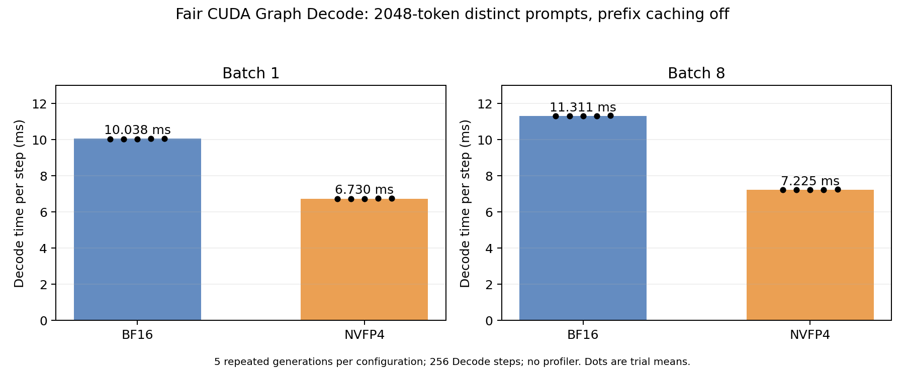
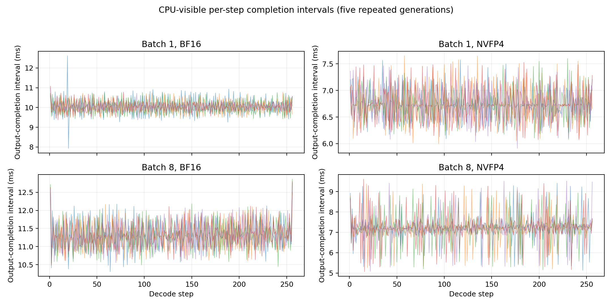

# 原生 NVFP4 剩余资源可利用性：阶段报告

记录日期：2026-11-16—17，Asia/Shanghai。

**已完成 Gate 0 的历史审计、方法与代码准备，以及 Gate 1 的四组公平性能基线，
共 20 次有效测量。尚未完成辅助 Kernel 的 GPU 校验和并发实验，不能声称证实了
可利用资源余量。** 新负载的 Kernel 组成还需单独 Node Trace 复核，Gate 1 尚有
这一项待收尾。

00:03:33 的只读检查确认其他用户已开始计算任务，占用 23752 MiB 显存，
当时 GPU 利用率 47%。探针启动前的安全检查已拒绝运行；我们的实验进程全部退出。
没有等待抢占、杀死其他用户进程、改变系统设置，也没有安排自动恢复。
证据：[停止状态](analysis/stop_status.json)、[被拒绝的启动记录](analysis/blocked_attempt.json)。

## 1. 本轮问题与历史证据边界

目标仍然是验证：精度从 BF16 切换到原生 NVFP4 后，真实 Graph Decode 的资源竞争
结构是否改变，以及这种变化能否让额外有效计算以可控代价执行。

此前 `nsys_round2` 的真实模型测量表明资源使用不同；其 Batch=8 Graph 中
BF16/NVFP4 的 DRAM Read 均值约为 79.3%/44.0%，SMs Active 约为 91.0%/53.6%。
这些是**历史负载、独立采样**的结果，本轮没有重新采集上述指标，也没有把它们
与新基线合成为一条同次测量记录。利用率差异不自动意味着可运行第二个 Kernel。

已读取任务指定的全部九份文件，并记录文件大小、行数及 SHA256，见
[gate0.json](analysis/gate0.json)。重点继承了 `audit_v3` 的以下修正：

| 历史问题 | 本轮处理 |
|---|---|
| 用 A-alone+B-alone 相加冒充串行测量 | 单独实测 serial AB、serial BA 的完整共同时间边界 |
| 两个精度使用不等 A/B 工作量 | A 固定形状与步数，B 固定有限 chunks/迭代数，不按模型速度校准 |
| API 同时提交或墙钟改善被当成 GPU 重叠 | 必须提取实际 CUPTI Kernel 区间，做并集与交集 |
| 提交 A 大批 Kernel 后才提交 B | B 预构建为独立 Graph，一次提交；同时保留 AB、BA 及起跑偏差 |
| 小缓存重复权重不代表真实推理 | A 使用真实整模型 Decode，禁止小矩阵权重循环作为替代 |
| FP32 探针实际上是大数组加法 | 使用寄存器中的四条 FMA 链，要求 PTX 与计算结果校验 |
| DRAM 探针是小数据反复访问或归约 | 独立 256 MiB 输入与输出，完整顺序拷贝，字节数明确 |
| 只保留比率中位数，无法核算 | 保存每次原始耗时、顺序、配置、输出和监督记录，后处理派生指标 |
| 把物理重叠解释为同 SM 共驻或抢占 | 时间线仅证明时间上的重叠；同 SM 驻留与具体干扰机制另需证据 |

没有沿用旧报告关于“更多中断/重填充”的因果断言；该解释仍是待验证假说。

## 2. 公平负载与计时定义

两模型分别为本机 Qwen3-8B BF16 与 NVIDIA Qwen3-8B-NVFP4，均采用：

- Graph 模式、默认异步调度、capture sizes `[1,8]`。
- `enable_prefix_caching=False`，KV 为 `fp8_e4m3`。
- FLASHINFER Attention，CUTLASS Linear，seed=0、temperature=0、ignore_eos。
- 每条 Prompt 为 2048 个 Token ID，Batch=8 的八条序列互不相同。
- 同一 Batch 下两种精度的完整输入 ID 完全相同；Batch=1 使用第 0 条序列。
- `max_num_seqs=8`，`max_model_len=4096`，`gpu_memory_utilization=0.85`。
- `max_num_batched_tokens=16384`，关闭 chunked prefill，两边保持一致。

将 token budget 从历史 8192 调整为 16384 的原因是：关闭 Prefix Cache 后，
8×2048 个 Prompt Token 都需要真实执行。不能让一半请求先进入 Decode，另一半
还在 prefill，然后仅截取后续看似 Batch=8 的片段。

原始调度记录验证了每次首个非空调度均为 8×2048（或 1×2048），且
`computed_before` 全部为 0；之后恰好 256 个 Decode 调度，每请求每次 1 Token，
无抢占。实际生成 257 个输出：第一个由 prefill 产生，其后为 256 个 Decode 输出。
实际 Graph Replay 恰好 256 次，没有用配置开关代替 Replay 检查。

两次 33-token generation 预热后，正式测量不使用 NSYS、NCU 或 torch.profiler。
计时从**第一次实际 Decode Graph Replay 提交前**开始，到第 256 个输出处理完成，
并确认 A 提交流上的结束 Event 完成为止。后续 CPU 自回归调度包含在内；prefill、
模型加载、编译与第一步提交前的准备不计入。

此边界比历史 round2 的首次 Decode scheduler 入口稍晚。再加上 Prompt、Prefix
Cache 与 prefill budget 已改变，**不能把历史延迟变化全部归因于 Prefix Cache**。
后续并发损失必须使用本协议、同会话重新测得的 A-alone 作为分母。

P50/P95 是 CPU 可见的逐步输出完成间隔；既不是单个 GPU Kernel 时长，也不是
五个独立进程的分位数。每个配置为一个独立模型进程内的五次有效 generation。
这满足当前重复次数要求，但尚不足以代替独立进程复验。

## 3. Gate 1 测量结果

| Batch | 精度 | 平均 ms/step | 每次均值范围 ms | P50 ms | P95 ms | 输出 Token/s | 256 步总时间 ms |
|---:|---|---:|---:|---:|---:|---:|---:|
| 1 | BF16 | 10.038 | 10.028–10.049 | 10.017 | 10.605 | 99.6 | 2569.8 |
| 1 | NVFP4 | 6.730 | 6.727–6.733 | 6.723 | 7.223 | 148.6 | 1723.0 |
| 8 | BF16 | 11.311 | 11.306–11.318 | 11.280 | 11.920 | 707.3 | 2895.6 |
| 8 | NVFP4 | 7.225 | 7.220–7.233 | 7.205 | 8.686 | 1107.3 | 1849.6 |

平均值与总时间跨五次 generation 求均值；表中 P50/P95 是每次 generation 分位数
的中位数；Token/s 为总 Batch 的输出吞吐。全部试验数据见
[baseline.csv](analysis/baseline.csv)，汇总见 [baseline_summary.csv](analysis/baseline_summary.csv)。

NVFP4 相对 BF16 的平均延迟加速约为 Batch=1 的 **1.49×**、Batch=8 的 **1.57×**。
这只是两种主任务的性能差异，**不是利用辅助资源获得的加速**。

五次试验均值的变异系数约为 0.034%–0.089%；逐 Token 尾延迟仍有波动，尤其 NVFP4
Batch=8 的 P95 高于其平均值较多。今后必须对照其自身逐试验 P95，不能因为平均
延迟损失小于 5% 就忽略局部 Decode 降速。

## 4. 公平性、环境与数据质量

[baseline_validation.json](analysis/baseline_validation.json) 对全部 20 次正式测量重新检查：

- 两模型设置和输入 ID 一致，八条输入互不相同。
- prefill 从零计算，Prefix Cache 未复用，Decode 实际 Batch 与长度正确。
- 各 256 个 Replay、256 次 Decode 调度、257 个输出，均无 preemption。
- 多出的一次为空调度，不包含额外模型前向；所有配置均为 258 次调度器调用、
  257 次非空调用。
- BF16 与 NVFP4 输出 Token Hash 不同，已记录；没有要求输出相同，也没有因此
  改变请求长度、提前停止或修改某一精度的采样参数。

监督日志每两秒读取 nvidia-smi，保留进程、时钟、功耗、温度与状态。映射到正式
Decode 窗口的样本数分别为 BF16 B1=6、BF16 B8=6、NVFP4 B1=4、NVFP4 B8=3。
这些是**稀疏观测**，不是连续测量，不能用于严谨的能耗积分或高分辨率功耗归因。
逐次采样值已写入 CSV，完整原文保留在 `logs/*_supervision.json`。

环境记录见 [environment.txt](environment.txt)：驱动 595.99.02，torch
2.14.0+cu132，vLLM 0.33.0+precompiled，Triton 3.8.0，FlashInfer 0.7.2.post1，
NSYS 2026.1.3。没有修复或调用 NCU。仍保留历史 FP8 KV scaling 警告，没有擅自
改变两模型的 KV 配置；本轮不是量化精度质量评测。

新负载的 Kernel 构成尚未重新采样。历史 Node Trace 已确认 BF16 B1 GEMV、B8
TensorOp，以及 NVFP4 的 SM120 E2M1 路径；本轮相同 backend 配置与实际 Replay
数量已检查，但**不以历史 Trace 冒充当前负载的 Kernel 组成证据**。

实测代码版本与当前开发源码有一个仅增加输出时间戳字段的差别，两个版本都已
冻结保存并逐个匹配原始 SHA256，见 [measured_source_map.json](analysis/measured_source_map.json)。

## 5. 三类辅助任务及公平并发代码的准备状态

| 模块 | 已完成的代码 | 尚需 GPU 验证 |
|---|---|---|
| FP32 | 4 条有结果依赖的 FMA 链；CTA/迭代/chunks 可控；CPU C `fmaf` 参考 | JIT、逐 chunk 输出抽样一致性、PTX FMA、寄存器及单独运行时间 |
| DRAM | 独立 256 MiB 输入/输出；完整 coalesced copy；全输出相等校验 | 实际带宽、低/中/高完整 passes、与主任务的缓存/DRAM 竞争 |
| Tensor | 固定 M64 N128 K1024，BF16 `tl.dot`；16 CTA；CPU 整数参考 | 实际 BF16 MMA、输出一致性、寄存器/SMEM、单独运行时间 |
| 空对照 | 独立 Graph、每 chunk 一个 stamp | 提交机制自身开销及所有 stamp 正确完成 |
| 调度器 | A-alone、B-alone、serial AB/BA、parallel AB/BA、empty AB/BA；原始逐次记录 | 流依赖、Graph 对外部 stream 的实际影响、隐藏同步、GPU 真实重叠 |
| 分析器 | 区间并集/交集、按 kernel 名识别辅助工作、配对 IA/RB/S、两种串行参考 | 当前版本的实际 SQLite Schema、设备身份及新 Trace 的交叉验证 |

以上是**准备完成、GPU 未验证的研究代码**，不是已通过正确性验收的探针。
DRAM 的 256 MiB 指单个缓冲区，合计 512 MiB；每个完整 pass 的逻辑读写量均计入。
它不以小缓存带宽冒充 DRAM。Tensor 探针刻意复用小操作数以施加计算压力，明确不
承担 DRAM 测量功能。FP32 每 FMA 计 2 FLOPs，四条链的工作量显式保存。

完整协议见 [methodology.md](methodology.md)。CPU 已通过 Python AST 检查、
Prompt 一致性检查，以及 200 组独立离散区间 oracle 对并集/交集分析的检查。
CPU 测试不能替代 Triton 编译、计算正确性或 NSYS 验证。

## 6. 失败、停止条件与没有获得的结果

第一次 NVFP4 B8 试跑被过严的“总调度次数等于 257”断言拦下。这是测量框架的
检查错误，已经改成检查非空调度数量，并保存后续失败状态。第一次未计入基线，
修正后重新运行五次，没有把失败样本择优挽救。

随后准备运行 `gate2_fp32_low` 时，预检发现其他用户的自动启动控制器，在创建
工作负载子进程之前退出；只读检查随后确认其计算进程已占用 GPU。故本次没有：

- B 单独执行的有效测量、输出校验或编译产物证据。
- A+B 的正式串行、并发耗时及 IA/RB/S。
- 新的 NSYS Node Trace、Metrics、物理重叠区间。
- 可利用余量或有用推理工作的正、负硬件结论。

详见 [failures.md](analysis/failures.md)。`timeline_validation.json` 为 `[]`，表示
没有新 Trace；没有填入虚构重叠率。任务要求的四张并发图尚不能生成，当前仅
提供两张有数据支撑的基线图。

产物整理中还发现一次部署误覆盖了汇总 `commands.txt` 的尾部。五份独立
`*_supervision.json` 都保留了各自的完整命令、环境、起止时间与状态，测量 JSON
没有受影响。原汇总文件保留，并据独立记录生成完整的
[commands_reconciled.jsonl](commands_reconciled.jsonl)，恢复过程见
[commands_reconciliation.json](analysis/commands_reconciliation.json)。部署脚本已
限制为源码、文档和派生分析，不再回写运行命令日志。

## 7. 对七个研究问题的当前回答

| 问题 | 当前回答 | 证据状态 |
|---|---|---|
| FP4 Decode 能否允许额外 Kernel 同时执行？ | 新协议下尚未测量 | 无法判断 |
| 是否比 BF16 更容易并发？ | 需要相同 B 工作量的两模型对照 | 无法判断 |
| FP32、DRAM、Tensor 哪类最易共存？ | 三类 GPU 探针均待校验 | 无法判断 |
| 对 FP4 平均与 P95 的损失？ | 已有公平 A 基线，尚无并发分子 | 无法判断 |
| 哪种方式保持延迟且完成更多工作？ | 独立 B Graph 是候选提交方法，未验证 | 无法判断 |
| 不能共驻时的原因？ | 尚未进行共驻试验，不能归因寄存器/SMEM/带宽 | 无法判断 |
| 能否转化为真实推理收益？ | 尚未进入有实际消费者的工作验证 | 无法判断 |

若使用任务书的三分法，目前只能记录**“当前无法证实可利用余量”**这一证据状态；
它不是“实验已经证明不存在余量”的结论 C，更不是结论 A。缺失的原因首先是
共享 GPU 窗口结束，不能将外部阻塞误写成硬件限制。

## 8. 下一空闲授权窗口的具体顺序

1. 只读检查 GPU 与控制器，确认授权窗口仍适用；不自动轮询并抢占空闲瞬间。
2. 给新公平负载补 A-alone 短 Node Trace，复核两精度、两 Batch 的实际 Kernel
   路径及 Replay。必要时做独立进程性能复验。
3. 先运行 FP32 短探针校验，检查输出、PTX/SASS 与资源，再完成 DRAM/Tensor
   的 Gate 2 校验；每项通过后才进入下一项。
4. 做 NVFP4 B8 + FP32 的 32-step 小试点，并独立采集 Node Trace。若无重叠，
   先检查提交顺序、流依赖与驻留，不扩大完整矩阵。
5. 确认真实 GPU 重叠后，在相同 B 工作量下增加 BF16 对照，再各做至少五个
   配对 block，保存 A/B/两种串行/两种并发/空对照完整记录。
6. 只有结果支持，才扩展资源种类、Batch=1，并寻找有消费者、无错误依赖的
   真实推理准备工作。有限 chunks 的成功不自动证明持续辅助执行也可行。

远程文件位于 `~/fp4-llm/results/resource_overlap_v1/`，本地均在
`D:\Apaper\北交\test\resource_overlap_v1\`。完整 Trace 将留在远程，不上传权重、
凭据、大型二进制 Trace 或 CUDA cubin。
